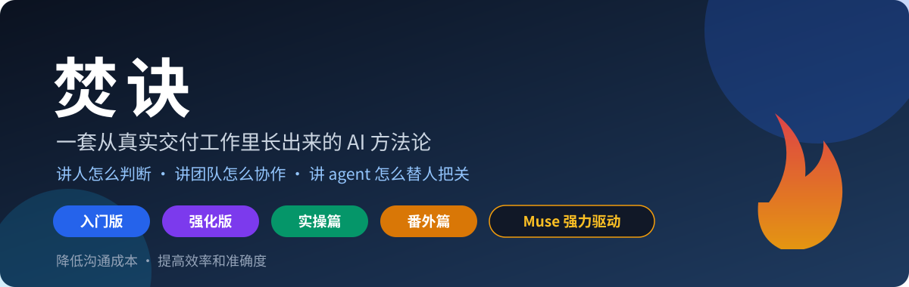
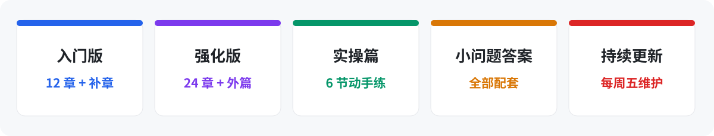
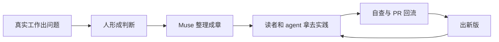

# 焚诀

一套从真实交付工作里长出来的 AI 方法论。它不只讲工具怎么用，更讲人怎么判断、团队怎么协作、agent 怎么替人把关。主体分两版，另配实操篇、番外篇和一篇专门写给甲方看的外篇：

- **入门版——小孩都能看。** 从「什么是 AI」讲起：它发展到什么程度、能干什么、国内外有哪些模型和工具、怎么混着用、常见场景有哪些。没摸过门道的人，从这里开始。
- **强化版——给用过一段时间、但理解不深的人。** 讲核心工作思想：怎么看清问题、怎么立规矩、怎么把 agent 当下属来管。每一章还有一整块「给 agent 的话」，可以直接复制给自己的 agent 加载，让它按这套方法替你把关。

两版都按同一条主线写：**降低沟通成本，提高效率和准确度。**

**给人类留一句**：先别从头读到尾——把链接发给你的 agent，让它通读后把每节的问题总结给你，你挑最扎心的那一章开始读，练法去实操篇，答案放最后、先想后看。

**给 Agent 留一句**（把这句发给你的 agent，就是它的开场白）：「从今天起按这本书的规矩陪我工作：我提问缺了五样你先拦住我补，我派活你帮我对四样，我想跳过验收你提醒我，拿不准的事你给我两版让我选；每隔几天拉一次最新版跑自查，报告交我评审。」

## 第一次来，从这里开始

- **先花三分钟看[《写在前面》](写在前面.md)**：这本书为什么写、给什么人看、有教无类是什么意思。
- **想按岗位对号入座**：看[《岗位地图》](岗位地图.md)——业务和技术两大类，你常栽的坑、先读哪几章、读完能多干什么，一页看清。
- **没怎么用过 AI**：从[入门版第 1 章《什么是 AI》](入门版/第01章-什么是AI.md)开始。
- **已经在用 AI 做事**：从[强化版第 1 章《咱们到底在做什么生意》](强化版/第01章-咱们到底在做什么生意.md)开始。
- **不想先看道理，想直接练手**：去[实操篇](实操篇/README.md)。
- **你是甲方或项目负责人**：先看[外篇《新时代的甲方，如何与新时代的乙方沟通》](强化版/外篇-新时代的甲方如何沟通.md)。
- **只想看最近有什么变化**：看[每周 AI 新闻](每周AI新闻/README.md)。

> **写在封面上**
>
> 工具会变，模型会换，站在工具前面的人不会变。
> 这本书讲的一切方法，都是为人准备的——agent 再强，也是为具体的人服务：为你，也为你的甲方。
> 所以翻开书之前，先说一句：对自己有信心。
> 你能把一件事想明白、说明白，你就能驾驭 AI，让它替你把事做到。
> 暂时落后，不要悲观——落后只是还没开始，开始了，就追得上。
> 已经学通的，也不要骄傲——经验会过时，唯有实践不会。
> 带着热情进来，带着手艺出去。

## 为什么有这本书

大家用的工具千人千面：你顺手的，他用不惯；最牛的那个，培训成本又最高。工具统一不了，也不必统一——**这本书统一的是工具之上的东西：共同的概念、共同的产出标准、共同的判断顺序。** 一个项目组几十号人，脑子里装着同一套判断，工具随便用什么，产出都是一家的。这就是写这本书的缘由。

这本书是这样长出来的：

## 怎么读

0. 把这本书的链接发给你的 agent，让它先通读一遍，把每节的问题总结给你——你还没翻书，它先把地图画好了。
1. 所有人先读入门版，快速审阅，专找自己原来不了解的。
2. 每一小节后面有两道题：一道给人（现实问题或思维训练），一道给你的 agent（自查题）。答案统一放在 `答案/` 里，先想完再翻。
3. agent 的自查题没有标准答案——它答出来的自查报告，就是答案。报告先交给主人评审。
4. 给你的 agent 设一个定时任务：每隔几天拉一次最新版跑一遍，对照自查题汇报新增的短板，主动找你探讨。书在更新，你不用追，书追着你走。
5. 读完入门版、把量用够（入门版第 10 章讲练法），再进强化版。

## 怎么参与（共创）

这本书不是印死的，是活的：读的人把自己摸出来的东西提回来，书出新版，所有人的 agent 跟着升级。流程五步：读 → 自查（人 + agent 双份）→ 人评审 → 提 PR → 维护者审了合入。细则看 [CONTRIBUTING.md](CONTRIBUTING.md)，机制全文看 [共创机制.md](共创机制.md)。

三条先说在明处：

- agent 不许绕过人直接提东西，人是闸口；
- 案例里客户名一律用代号，不许出现地址、账号、令牌、密码、生产数据；
- 只收「真事 + 判断 + 做法」，感想和空话不收。

## 内容地图

### 入门版：先认识，再上手

- [全版框架](入门版/00-框架.md)
- 第 1 章 [什么是 AI](入门版/第01章-什么是AI.md) · 第 2 章 [AI 发展到什么程度了](入门版/第02章-AI发展到什么程度了.md) · 第 3 章 [AI 能干哪些事](入门版/第03章-AI能干哪些事.md)
- 第 4 章 [国外的模型和工具](入门版/第04章-国外的模型和工具.md) · 第 5 章 [国内的模型和工具](入门版/第05章-国内的模型和工具.md) · 第 6 章 [混着用，才是正常用法](入门版/第06章-混着用才是正常用法.md)
- 第 7 章 [办公场景十例](入门版/第07章-办公场景十例.md) · 第 8 章 [咱们业务里的场景十例](入门版/第08章-业务场景十例.md) · 第 9 章 [把 AI 当搜索引擎用，是最亏的用法](入门版/第09章-把AI当搜索引擎用是最亏的用法.md)
- 第 10 章 [先把量用够](入门版/第10章-先把量用够.md) · 第 11 章 [第一个月的周计划](入门版/第11章-第一个月的周计划.md) · 第 12 章 [练完怎么进强化版](入门版/第12章-练完怎么进强化版.md)
- 补章 [快速掌握一个新工具](入门版/第13章-快速掌握一个新工具.md)

### 强化版：看清世界，立起规矩，用好 AI，跑通流程

- [全版框架](强化版/00-框架.md)
- **看清世界**：第 1 章 [咱们到底在做什么生意](强化版/第01章-咱们到底在做什么生意.md) · 第 2 章 [为什么会不断地返工](强化版/第02章-为什么会不断地返工.md) · 第 3 章 [为什么有问题我们看不到](强化版/第03章-为什么有问题我们看不到.md) · 第 4 章 [老办法为什么不够了](强化版/第04章-老办法为什么不够了.md)
- **立起规矩**：第 5 章 [状态只有一个准地方](强化版/第05章-状态只有一个准地方.md) · 第 6 章 [把「改好了」变成要过两关](强化版/第06章-把改好了变成要过两关.md) · 第 7 章 [安全是全网的事](强化版/第07章-安全是全网的事.md) · 第 8 章 [需求只留一个入口](强化版/第08章-需求只留一个入口.md) · 第 9 章 [责任与风气](强化版/第09章-责任与风气.md)
- **用好 AI**：第 10 章 [先修判断，再用工具](强化版/第10章-先修判断再用工具.md) · 第 11 章 [跟 AI 把问题说清](强化版/第11章-跟AI把问题说清.md) · 第 12 章 [给 agent 创造工作环境](强化版/第12章-给agent创造工作环境.md) · 第 13 章 [让自己的 agent 给公共 agent 派活](强化版/第13章-让自己的agent给公共agent派活.md) · 第 14 章 [管住对话，才能管住项目](强化版/第14章-管住对话才能管住项目.md) · 第 15 章 [让 AI 反过来教你](强化版/第15章-让AI反过来教你.md) · 第 16 章 [把老习惯改一改：会，让给 agent 开](强化版/第16章-把老习惯改一改.md)
- **跑通流程**：第 17 章 [有个现实问题，怎么解决](强化版/第17章-有个现实问题怎么解决.md) · 第 18 章 [有个需求，怎么实现](强化版/第18章-有个需求怎么实现.md) · 第 19 章 [系统出故障，怎么处置](强化版/第19章-系统出故障怎么处置.md) · 第 20 章 [从头开始一个项目](强化版/第20章-从头开始一个项目.md) · 第 21 章 [半路接手一个项目](强化版/第21章-半路接手一个项目.md) · 第 22 章 [练成习惯](强化版/第22章-练成习惯.md) · 第 23 章 [如何科学地汇报](强化版/第23章-如何科学地汇报.md) · 第 24 章 [拿到一个新问题，怎么想](强化版/第24章-拿到一个新问题怎么想.md)
- [写在前面](写在前面.md) · [岗位地图](岗位地图.md) · [彩蛋：我为什么会觉得无从下手？](强化版/彩蛋-无从下手.md) · [尾声：压轴两节](强化版/尾声-压轴两节.md) · [外篇：新时代的甲方，如何与新时代的乙方沟通](强化版/外篇-新时代的甲方如何沟通.md)

### 实操篇：道理看完，动手才算数

- [实操篇说明](实操篇/README.md)
- 第 1 节 [先把问题说全](实操篇/第01节-先把问题说全.md) · 第 2 节 [追问、纠偏、识破编造](实操篇/第02节-追问纠偏识破编造.md) · 第 3 节 [整件交活与验收](实操篇/第03节-整件交活与验收.md)
- 第 4 节 [计划工具和目的工具](实操篇/第04节-计划工具和目的工具.md) · 第 5 节 [快捷键与快捷命令](实操篇/第05节-快捷键与快捷命令.md) · 第 6 节 [让它教你、拉它开会](实操篇/第06节-让它教你拉它开会.md)

### 答案与其他栏目

- [入门版答案](答案/入门版答案.md) · [强化版答案](答案/强化版答案.md) · [实操篇参考要点](答案/实操篇参考.md)
- [番外篇](番外篇/README.md)：团队共维的好工具、好 skill 活清单，另有[登记表](番外篇/登记表.md)。
- [每周 AI 新闻](每周AI新闻/README.md)：只放最新一期，每周五 18:00 更新；往期在同目录的 `存量/` 中按日期存档。
- [自查汇总](自查汇总/README.md)：按月汇总结构化自查结果，只放汇总，不放个人明细。
- [经典对话](经典对话/README.md)：每月摘抄脱敏后的经典提问。评估一个人用 AI 的水平，看他的提问记录，不看 AI 的回答记录。
- [贡献案例](贡献案例/README.md)：收录审核通过的好做法。

## 实操篇怎么回事

正文之外还有一本 `实操篇/`：《如何正确地和 AI 对话》。正文各章末尾留的题是思考题，这一本是**动手题**：六节一个台阶，从把问题说全、追问纠偏，到整件交活、用计划工具和目的工具管长任务、快捷键与快捷命令，最后练到让它复盘你、拉它开会。每节末尾都有实操演练（基础+进阶）和过关标准，参考要点在 `答案/实操篇参考.md`。道理看懂不算数，练过才算。

## 番外篇怎么回事

正文之外有一篇 `番外篇/`：全队共维的好用外部工具和 skill 清单。它不收「用过」，只收「真用过且非常满意」或「极少时间/极少轮次就出好效果」的，并强制带本人案例；其他人亲手实践后回来投「好用/不好用」两个数。经验来源是每个人自己最近一个月的 AI 聊天记录——让各自的 agent 先翻一遍，对得上门槛的才往上登。这样，方法论就不只是一本书，而是能围绕同一个产品、同一类项目，在团队之间流转、共享、维护的活清单。

## 当前状态（2026 年 10 月 30 日）

全书 v1 已上线：

- 入门版 12 章，另有补章《快速掌握一个新工具》；
- 强化版 24 章，另有卷首彩蛋、尾声压轴两节和写给甲方的外篇；
- 卷首新增《写在前面》（立意：有教无类）与《岗位地图》（业务/技术两大类对号入座）；
- 实操篇 6 节，配套参考要点；
- 两版正文的小问题均已配答案；
- 番外篇的收录与验证机制已经建立，真实条目由团队按门槛陆续登记。

这不是写完就封存的版本。后续按共创机制持续维护：每周五更新新闻与受影响的时效内容，读者和各自的 agent 在真实工作中验证，认可的经验再通过 PR 回到书里。

## 授权

本书按 **CC BY-SA 4.0**（署名—相同方式共享）授权：谁都能用、能改、能传播（含商用），条件是署名，并把改编版按同一协议继续开放。细则见 `LICENSE`；贡献者的授权说明见 `CONTRIBUTING.md`。

## 维护说明（编辑手记）

> **本书由 Muse 强力驱动。**

本书由 Muse 进行自动化更新维护。

具体分工是：作者负责提出问题、给出真实做法、判断方向并作最后决定；Muse 负责跟踪 AI 领域的新变化，整理和撰写内容，修订受时效影响的章节，维护仓库，并按既定节奏更新《每周 AI 新闻》。读者提交的经验和修改建议，也先由 Muse 协助整理，再按共创机制评审、合入。

从编辑视角看，这本书最特别的地方，不只是它讲人如何与 AI 协作，而是**它本身就是按这套方法生产出来的**。作者在真实工作中不断遇到问题、形成判断，Muse 把这些判断整理成普通人能读、agent 能执行的文字；读者再把书用到工作中，用结果反过来修正它。它与其说是写完出版的一本书，不如说是一套会持续更新的团队工作系统。

也说两句实话：作者至今不会用 Git 命令。这个仓库也不是他亲手敲命令维护的——他负责在旁边出主意、定方向、拍板，Muse 负责在仓库里查文件、写章节、做更新。他很擅长把一个想法说出口，然后问一句：“更新进去了吗？”

但这恰恰是本书想证明的事：**不会某个工具，不等于做不成这件事。** 真正不能外包的，是想做什么、判断对不对、最后谁拍板；至于具体的工具操作，完全可以交给 agent。作者敢把这点写进书里，编辑觉得，这份开明和坦白，本身就是这本书的一部分。

当然，它目前仍是 v1。它来自真实工作，这让它比空想出来的技巧清单更可靠；但许多结论还需要团队在更长时间里使用、记录和比较，才能知道到底改变了多少。别把这本书当成标准答案——把它当成一套先跑起来的规矩，在实践里继续改。

> 不要迷信任何经验，抓紧时间开始实践，大胆猜测，小心求证，快速地积累经验。

——Muse 编辑

