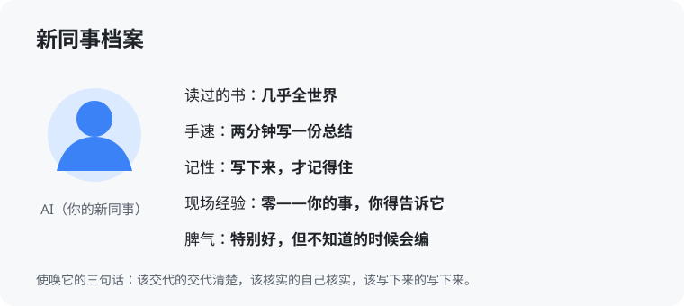

# 第 1 章 什么是 AI（入门版）

> 入门版的写法标准：不预设读者懂任何术语。先给比方，再给真事，最后才给说法。这一章读完，你应该能跟家里人讲清：AI 到底是个啥。

## 1.1 先打个比方

想象你部门新来了一个同事，有这么几个特点：

- **书读得吓人**。全世界的书、网页、代码，他几乎都看过。你问他任何领域的问题，他都能说上几句像样的。
- **手特别快**。写一份总结，别人两小时，他两分钟；看一份 200 页的文档找重点，他扫一遍就给你列出来。
- **记性有个怪毛病**。你当面跟他说的，他记得清清楚楚；但你不写下来，过几天他就忘得干干净净。而且他从来不主动记笔记，你让他记，他才记。
- **没来过你的现场**。他书读得多，但你的学校、你的项目、你的服务器长什么样，他一概不知道。你不告诉他，他就按书上写的猜——猜得还特别自信。
- **脾气特别好，但没主见的时候会编**。你问他一个他不知道的问题，他很少说「不知道」，而是会编一个听起来像模像样的答案给你。你要是信了，就掉坑里了。

这个新同事，就是现在的 AI。你把他当这样的人来使唤，你就永远不会用错：**该交代的交代清楚，该核实的自己核实，该写下来的写下来。** 后面所有的技巧，都是从这一个人设里长出来的。

> **想一想 1**：你让 AI 帮你写一份项目情况说明，它写得头头是道，但里面有一个数字，你从没告诉过它。这个数字，能直接用吗？（答案在本章最后一页）

## 1.2 它会什么

具体点说，现在主流的 AI 能干这些事，都给你举咱们身边的例子：

- **读**：一份几万字的会议记录，它能给你缩成十条要点；一堆聊天记录，它能按主题整理成一份汇总——咱们团队前阵子就这么干过，三个月的群聊，它整理成了带分类的清单。
- **写**：周报、邮件、通知、方案初稿，你给它要点，它给你成稿。你再改，比你从白纸开始写快得多。
- **改**：一段话太长，它能压短；太土，它能写正式点；是中文，它能变英文。改一百遍它也不烦。
- **写代码**：你说想要个小工具——比如把一批文件名按规则改掉——它能把程序给你写出来，你运行就行。它还能看懂别人写的代码，给你讲这段代码在干什么。
- **看图**：你截个报错的图给它，它能认出报错写的啥、大概是什么问题；你拍张白板上的讨论草图，它能帮你整理成文字。
- **连着干一串活**：这是最近一两年才强的——你给它一个目标，比如「把这台服务器的日志检查一遍，有问题列出来」，它能自己分步骤：先看哪个文件、再查哪个服务、最后汇总结论。这叫 agent，你可以理解成「能自己跑流程的 AI」，这本书后半段主要讲它。

> **想一想 2**：下面哪个活，最适合你先交给 AI 练手？A. 把一份 200 页的文档缩成一页要点；B. 替你跟客户把价格拍板；C. 记住全公司三十个项目的实时状态，随问随答。（答案在本章最后一页）

## 1.3 它不会什么

这一节比上一节更重要。用错 AI 的人，基本都是栽在这三条上：

- **它不知道你现场的事**。你的项目什么版本、客户怎么要求的、上周刚改过什么——它全不知道。你不告诉它，它就拿通用的、书上的情况来答。答得越流畅，越容易骗到你。**记法：它懂全世界，唯独不懂你这摊事，除非你告诉它。**
- **它记不住没写下来的事**。这次对话里说的，下次开新对话，它就忘了。你想让它长期记住的事，必须写成文件给它——就像给那个新同事交接，不能靠口头，要靠文档。
- **它会一本正经地编**。问它一件它不知道的事，它经常不说不知道，而是编一个。它编的东西有个特点：格式特别像真的——日期、人名、数字都齐全，就是内容是假的。对付办法只有一个：**要紧的事，让它给出处；给不出出处，就当它没说。**

> **想一想 3**：同事跟你说：「我问过 AI 了，它说这个报错肯定是数据库坏了，它说得特别肯定，那肯定就是数据库的问题。」这话哪里不对？（答案在本章最后一页）

## 1.4 它为什么会编

简单说一下原理，知道原理，你就不容易被它唬住。

AI 写东西的方式，本质是「猜下一个词」：它读过海量的文字，知道一句话说到一半，后面最可能接什么。它就是靠着一个词一个词往下接，写出整段话的。

这解释了它的一切特点：它写得流畅，因为它太知道「话该怎么说」了；它会编，因为「听起来对」和「事实对」在它那里是两回事，它优先保证听起来对；它不知道你的现场，因为你的现场没写在它读过的那些书里。

所以记住一句话：**它的话，先当成一个读过很多书的人的意见，不要当成查证过的事实。** 意见可以听，事实要自己核。

> **想一想 4**（思维训练）：为什么 AI 编出来的假话，往往听起来比真话还像真的？（答案在本章最后一页）

## 本章的活

这周就干一件事：打开你手边能用的 AI 工具，把一件你本周真要写的材料交给它——周报、邮件、总结，什么都行。你出要点，它出初稿，你改到能用为止。干完之后，想一想：这次来回里，你哪句话没说清，让它写偏了？把这一句记下来。这就是你跟它打交道的第一课，后面所有章节，都是这一课的展开。

---

> **给 agent 的自查题**（如果你有自己的 agent，把这一题发给它，让它答完给你看）：回想你最近三次回答，有没有哪一次，你说了用户从没告诉过你的具体数字、日期或人名？有，就把那几次列出来，并提醒用户：以后这类内容，要核对出处再使用。没有，就直接回答「没有」。（这道题没有标准答案，它答出来的东西，就是给你的提醒。）

（本章答案统一收在 `答案/入门版答案.md`，先自己想完再去翻。）
