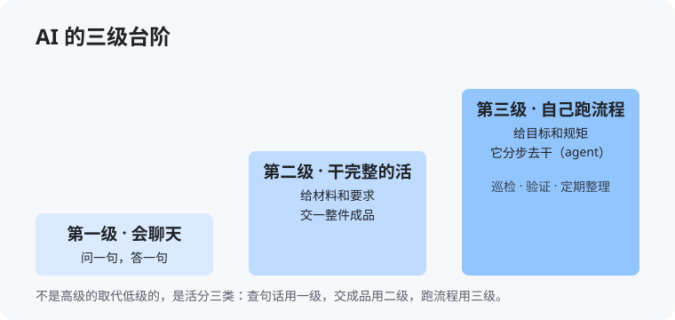

# 第 2 章 AI 发展到什么程度了（入门版）

> 这一章就讲清一件事：它现在到底有多能干，你该拿它当几级的帮手来使。夸它的人把它说成神，骂它的人把它说成傻子——两个都不对。它是一个强弱分布很奇怪的帮手，先把分布摸清，你才不会用错。

## 2.1 三级台阶：聊天、干活、跑流程

这几年 AI 的进步，可以分成三级台阶。你平时听到的大部分争论，都是因为大家站在不同的台阶上说话。

**第一级：会聊天。** 你问一句，它答一句。查个概念、翻译一句话、帮你想几个标题——都是这一级。它像一个随叫随到的词典加秘书，问完就完事，它不会接着往下干。几年前大家第一次接触 AI，接触的就是这一级，很多人对 AI 的印象还停在这里。

**第二级：能干完整的活。** 你给它一份材料和一个要求，它交给你一整件成品。你把两小时的会议录音给它，它给你一份带决议和待办的纪要；你把一段报错和相关代码给它，它把改好的代码给你；你给它一堆聊天记录，它给你一份分好类的汇总。这一级的关键是：**任务有头有尾，你验收的是成品，不是陪它聊天。** 现在主流的工具，认真用，都在这一级。

**第三级：自己跑流程，也就是 agent。** 你给它的不是一道题，是一个目标和一套规矩，它自己分步骤去干：先查什么、再看什么、发现问题怎么处理、干到什么程度停下来汇报。比如「每晚把这几台服务器巡检一遍，有异常列出来发我」「新版本验一遍，三个角色的账号都点到，挂的项列清单」——这种要持续跑、要分步、要查状态的活，是第三级。这一级现在正在快速成熟，咱们这本书的后半段，主要讲的就是怎么站到这一级上来。

三级的关系记牢：**不是高级的取代低级的，是活分三类。** 查句话用第一级，交成品用第二级，跑流程用第三级。用第一级的方式去使唤第三级的工具，就像买了辆卡车只拿它买菜——不是车不行，是你没装货。

> **想一想 1**：你想让 AI「盯着这台服务器，有异常就告诉我」。这是第几级的事？打开聊天框问它一句，能做到吗？（答案在 `答案/入门版答案.md`）

## 2.2 它最强的地方，和它最容易闹笑话的地方

先说强的地方，都是你现在就能用上的：

- **读得快**。一份你读两小时的文档，它几分钟给你要点；几百条聊天记录，它能按主题分好类。这种「量大、要有耐心」的读法，它比任何人都稳——它不累，也不烦。
- **起稿快**。通知、总结、方案、脚本，从白纸到六成像样的初稿，它的速度是人的几十倍。你在它的稿子上改，永远比你自己写快。
- **样样懂一点**。写代码、查资料、翻外语、看报错、做表格，一个帮手全包。很多小活以前要等专业的人，现在你自己带着它就能干——这件事的意义，第 10 章细讲。

再说它容易闹笑话的地方，这几样你要心里有数：

- **简单的数会算错**。它写得出复杂的程序，却可能把两位数的乘法算错。原因在第 1 章讲过：它本质是顺着话往下接的，算数不是它的长项。办法也简单：要算数，让它写个小程序去算，或者让它调用计算工具，不许它心算。
- **会编不存在的东西**。问它一本书、一个文件、一条规定，它可能一本正经地给你编一个出来，连章节页码都齐全。对付办法还是那句：要紧的事让它给出处，给不出就当没说。
- **不知道新事和你现场的事**。它读的书有个截止时间，太新的事它不知道；你现场的版本、配置、客户要求，它更不知道（第 1 章的老话）。所以它涉及版本、日期、现状的回答，都要多留个心眼。

把这两份清单放一起，你就明白为什么有人夸有人骂了：**夸的人用的是它的强项，骂的人撞上了它的弱项。** 它不是神，也不是傻子，它是一个强弱分得很开的帮手——用对了地方，顶好几个人；用错了地方，笑话百出还耽误事。

> **想一想 2**：同事说：「AI 连两位数的乘法都能算错，这玩意儿根本不能用。」用本节的道理，你怎么回他？（答案在 `答案/入门版答案.md`）

## 2.3 一条判断：它涨得很快，你的经验要定期重验

最后给一条判断，这是这一章最值钱的一句：**AI 的能力涨得非常快，快到你的经验会过期。**

一年前它写不好的脚本，现在可能写得很好；半年前它一干就砸的活，现在可能已经干得有模有样。反过来也一样：别人说「这工具特别强」，你也要问一句，那是什么时候的评价？

所以养成一个习惯：**每隔几个月，把以前它干砸过的一件活，再拿出来让它试一次。** 干成了，你的经验库更新一条，又多一个能交出去的活；干砸了，也记清它现在卡在哪一级、哪一步。这个习惯还有一层意思：这本书为什么要放在网上活更新，而不是印成一本发下去——道理一样，印出来的那天就开始过期了，活的版本才能追上它涨的速度。

> **想一想 3**（思维训练）：半年前你让 AI 写过一个巡检脚本，它写得一塌糊涂，你从此再也不让它碰脚本了。按本章的判断，你漏了一个什么动作？（答案在 `答案/入门版答案.md`）

> **给 agent 的自查题**（发给你的 agent）：你现在被主人当第几级在用？想一想：有没有一件「第三级的事」——需要你自己分步跑流程、查状态、再汇报的活——主人还没交给你、还在自己手工干？挑最值得接手的一件，连同接手需要的前提（要什么权限、要什么清单），一起报给主人。

## 本章的活

这周就干一件事：把以前让 AI 干砸过的一件活，重新让它试一次。不管成没成，把结果记下来：成的，写清现在它能干到什么程度；没成的，写清它卡在哪一步。这张记录，就是你自己的「能力重验表」的第一行——以后每隔几个月，往下添一行。
