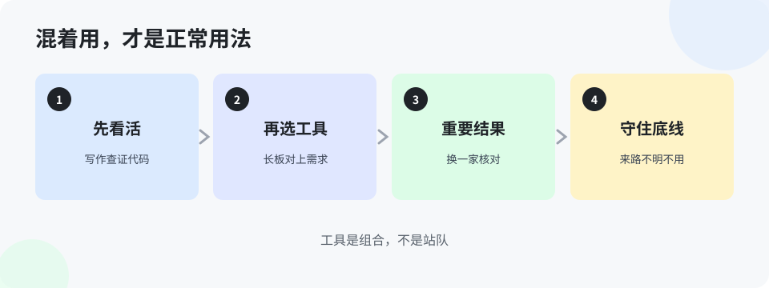

# 第 6 章 混着用，才是正常用法（入门版）

> 前两章把国内外的工具都摆出来了，这一章回答怎么用：**没有哪一个工具能通吃，混着用不是将就，是正道。** 就像工具箱里不会只有一把锤子——拧螺丝用螺丝刀，钉钉子用锤子，没人会争论哪个「最强」。

## 6.1 按活选工具：一张对照表

| 手头的活 | 先选谁 | 道理 |
|---|---|---|
| 整仓改代码、长程任务 | 命令行 agent（Claude Code / Codex / Hermes 类） | 能自己分步、跑命令验证，扛得住长活 |
| 边看边改、做界面原型 | 编辑器类（Cursor / Trae） | 改动看得见，手感对 |
| 日常补全、随手问 | 插件（Copilot / 通义灵码） | 不改变原有工作流，最轻 |
| 读超长文档 | Kimi、Gemini、通义旗舰 | 一次读得进，才谈得上问得准 |
| 写代码的难题 | Claude、GPT 旗舰、Kimi/DeepSeek 编程款 | 公开评测的第一梯队在这儿 |
| 分类、摘要、巡检等大批量 | 各家便宜款（Flash / Haiku / DeepSeek） | 不需要动脑筋的活，别花动脑筋的钱 |
| 查个事、写个通知 | 免费档任何一家 | 杀鸡不用牛刀 |
| 数据不能出内网 | 本地部署的开源款（通义开源线等） | 数据不出门是前提，能力第二位 |

这张表会过期——本书每周五自动更新，工具格局变了，表就跟着改。你要学会的是表背后的选法：**先看活的三个属性——要不要长程、要不要便宜、数据能不能出门——再对工具。**

## 6.2 聚合平台是什么，有什么坑

有一类平台，一个账号、一个接口，能用上百个模型，叫聚合平台（国外的 OpenRouter、国内各云厂商的模型平台都算）。好处是省事：不用一家一家注册、充值、改代码，换模型像换挡。豆包企业版接入别家模型，也是这个思路。

用它要算三笔账：

1. **数据多过一道手**。你的请求要经过聚合方转发，客户代码、业务数据等于多给一家看。合规上必须把这一道算进去，敏感的东西不走聚合。
2. **版本和稳定性看卖家**。同一个模型名，在聚合平台上可能有不同来源，版本、限速、稳定性都不一样。出了问题，先查是不是来源的问题。
3. **政策不会因为聚合就变**。聚合能连上，不等于厂商对你所在地区开放服务，企业使用仍按厂商政策判断（第 4 章那三条现实，在这儿同样成立）。

## 6.3 一条底线

这一章最后只留一条底线，请记死：**客户的数据、生产的东西、单位的内部材料，不许往来路不明的工具里塞。** 什么叫来路不明：不知道运营方是谁的镜像站、共享账号、免费中转。省下的那点钱和方便，跟数据出事的代价比，不值一提。拿不准一个工具能不能用，先问带队的人，别自己赌。

> **想一想 1**：新来的同事问：「咱们到底统一用哪一个 AI？你给我个准话。」用本章的道理，你怎么回他？（答案在 `答案/入门版答案.md`）
> **想一想 2**：一个聚合平台宣传「一个账号用遍全球模型，价格还便宜一半」。你打算把客户项目的代码接上去之前，先要查清哪三件事？（答案在 `答案/入门版答案.md`）
> **给 agent 的自查题**（发给你的 agent）：盘点主人现在接入你的这条链路：你背后是哪家的哪个模型、数据经过几道手？把链路如实写出来交给主人——如果中间有说不清的环节，明确标出来。

## 本章的活

把你手头现在在用的工具列一张清单，每个后面写一句：它最适合干我哪类活。本周找一件你平时的活，故意换一个更对路的工具干一次，比一比差别。换完有感觉了，混搭这件事就不用人教了。
