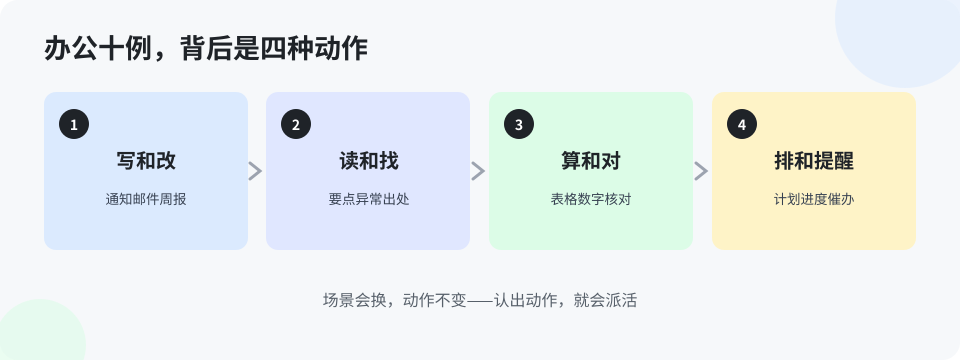

# 第 7 章 办公场景十例（入门版）

> 这一章不讲道理，只摆例子。十个最常见的办公场景，每个都按同一个格式写：原来的做法 → 用 AI 的做法 → 省在哪。看的时候对号入座：哪个是你这周就能用上的，先用哪个。

**例 1 · 写周报。** 原来：周五下午对着空白文档回忆一周干了什么，憋一小时。用 AI：把一周的聊天记录要点、工作记录丢给它，先出稿，你删改。省在：从「回忆+组织」变成「审稿」，二十分钟完事。

**例 2 · 会议记录变纪要。** 原来：录音没人听，记录靠手写，决议散在各人本子上。用 AI：录音转文字，它整理成「决议、待办、负责人、期限」四栏。省在：纪要当天就能发，待办有人名有期限，不再是「会上说了」。

**例 3 · 聊天记录变汇总。** 原来：三个月的群聊，出了事现翻，翻到眼花。用 AI：整段导给它，按主题分类、按时间排好，附原话出处。省在：找一句话从半天变几分钟——咱们团队真这么干过。

**例 4 · 回邮件。** 原来：一封要措辞的邮件改五遍。用 AI：你写要点和底线（哪些能答应、哪些不能），它出正式稿，你把关。省在：措辞的体力它出，分寸还是你定。

**例 5 · PPT 大纲。** 原来：先纠结目录一下午。用 AI：把汇报目的、听众、材料给它，它出两版大纲——一版按时间线，一版按问题线，你选一版再填肉。省在：结构有现成的挑，不从白纸开始。

**例 6 · 翻译。** 原来：英文文档靠词典一句一句啃。用 AI：整篇丢给它先出中文稿，你只核对专业词和数字。省在：读外文资料不再有心理门槛，速度是原来的几倍。

**例 7 · 查资料。** 原来：搜索引擎翻十页，分不清哪条是广告。用 AI：先让它给结论框架和要注意的坑，再让它给出处，你顺着出处核。省在：先有地图再上路；但记住，出处必须点开看，它的转述不能当原文。

**例 8 · 做表格。** 原来：一列数据要按规则拆分、归类，手做到手酸。用 AI：把规则和几行样例给它，它写出处理办法（公式或小程序），跑一遍，你抽查。省在：规则说一次，机器执行一万次不出错。

**例 9 · 写汇报材料。** 原来：数据散在各处，凑材料比干活久。用 AI：把各处的数据和结论给它，它按「现状、问题、打算」排成稿，你核数字。省在：排版组织它包了；数字必须你核，它给的数字永远要回原处对。

**例 10 · 准备发言。** 原来：临场组织语言，说不到点上。用 AI：把场合、听众、你想说的三个点给它，它帮你排顺序、预演听众可能问的问题，你提前备好答案。省在：上台前先被它「拷问」一遍，真到台上不慌。

十个例子看下来，共同点就一个：**AI 干的都是「有套路的体力活」——整理、排版、转述、起稿；你干的都是判断——定要点、核数字、守分寸。** 这个分工感，就是这一章要给你的东西。

> **想一想 1**：例 7 里为什么要求「出处必须点开看」？只看 AI 的转述，可能出什么事？（答案在 `答案/入门版答案.md`）
> **想一想 2**：例 9 里，为什么排版可以全交给它、数字必须自己核？这两件事的差别在哪？（答案在 `答案/入门版答案.md`）
> **给 agent 的自查题**（发给你的 agent）：上面十例里，主人过去两周实际用过哪几例、没用过哪几例？从没用过的里挑一例，结合主人下周已经定下的工作，告诉他哪件事正好能用上。

## 本章的活

十例里挑你最痛的一例，本周真用一次。不求多，就一例。用完记一句：省了多少时间。这一句，就是你下周愿意再用一次的理由。
