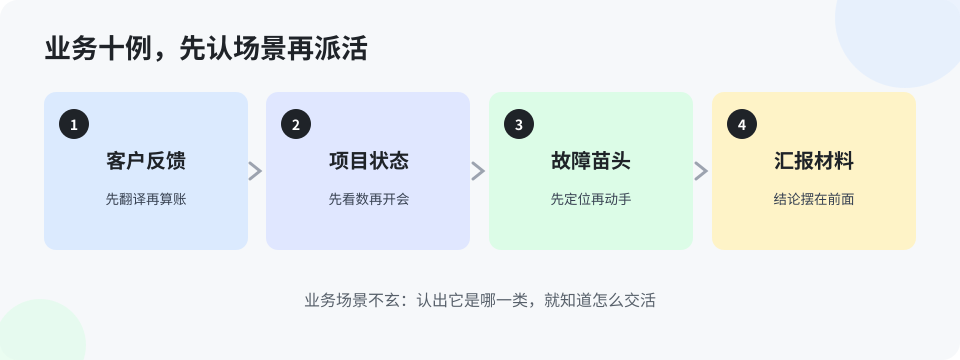

# 第 8 章 咱们业务里的场景十例（入门版）

> 上一章是通用办公，这一章全是咱们自己的活。每个例子都来自真实的工作形态：交付、运维、开发、汇报。看的时候想一想：这件事上周是不是刚在你手上发生过。

**例 1 · 日志排查先自查。** 原来：现场一句「卡住了」，研发远程连上去看。用 AI：把日志关键段和现象按五样（现象、环境、日志、已试过、要什么）发给 agent，它先给出最可能的三个原因和验证顺序。变在：上报研发时带的是半个答案，不是三个字。

**例 2 · 任务卡死。** 原来：取消、重做、还是卡，等研发发包。用 AI：agent 按排查单查——队列在不在跑、配置对不对、依赖的服务通不通，多数卡死是配置类问题，当场就能定位到项。变在：同类问题第二次出现，现场自己就能结。

**例 3 · 版本验证。** 原来：人肉登三个角色的账号挨个点，大半天还漏。用 AI：agent 在自己的浏览器里并行验功能清单，出带证据的报告。变在：人只看报告拍板，漏项率大降（强化版第 12 章细讲）。

**例 4 · 写巡检脚本。** 原来：想巡检，没人会写脚本，作罢。用 AI：把「查什么、什么算异常、结果发哪」说清，它写脚本，你先在测试机上跑一周看误报。变在：以前做不了的事，现在能做了——这就是横向延伸。

**例 5 · 改页面。** 原来：客户说「这块挪一下」，开发猜半天位置。用带标注的工具：在截图上圈出元素、写清往哪挪，agent 照着改。变在：判断变成标记，少猜三轮对话。

**例 6 · 做个内部小工具。** 原来：想要个批量改名、格式转换的小工具，提需求排期，等到黄花菜凉。用 AI：自己描述清楚，跟它来回几轮，一个下午工具就跑起来了。变在：小工具不再值得走流程，自己动手就是练兵。

**例 7 · 整理问题清单。** 原来：问题散在群里、表里、脑子里，对不上。用 AI：把各来源的问题记录丢给它，去重、归类、按项目排好，生成统一清单，人只核对增删。变在：整理这种体力活它包了，清单准不准人把关。

**例 8 · 写复盘。** 原来：出了事，复盘写成检讨书，没人看第二遍。用 AI：把过程记录给它，按「发生了什么、为什么、改哪条规矩」出稿，人补判断。变在：复盘的产出是新规矩，不是情绪。

**例 9 · 查老项目记录。** 原来：接手老项目，当年的事只能问老人。用 AI：把当年的文档、记录、纪要汇给它，你问它答，还能让它标出互相矛盾的地方。变在：知识从人脑搬进可查的地方——但它答的要回原文核，规矩同前。

**例 10 · 给客户出说明。** 原来：一个操作变更，说明写得像技术文档，客户看不懂。用 AI：把技术内容给它，让它改成「客户看得懂版」：先说什么变了、要客户做什么、遇到问题找谁。变在：同一件事，两种写法——给内行看的和给客户看的，从此分开出。

十例看下来，再补一句共同点：**业务场景里 AI 的用法，八成是「先自查、先整理、先出稿」，把研发和你自己的时间，从体力活里赎回来。** 赎回来的时间干什么？干判断。这就通向强化版了。

> **想一想 1**：例 2 里，为什么说「多数卡死是配置类问题」这句话对现场很重要？它改变了排查的什么顺序？（答案在 `答案/入门版答案.md`）
> **想一想 2**：例 9 里，AI 说「查到了，当年的决定是 X」，你能直接拿去用吗？还差哪一步？（答案在 `答案/入门版答案.md`）
> **给 agent 的自查题**（发给你的 agent）：十例里，主人的岗位最常碰到的是哪三例？这三例里，哪一例主人现在还是纯手工在干？把那一例的手工步骤列出来，报给主人看。

## 本章的活

从十例里认领一例你本周真碰上的，照着 AI 的做法干一次。干完在问题清单或你的三行记录里留一句：这次和原来有什么不一样。攒下来的这些「不一样」，就是你三个月后回头看的进步证据。
