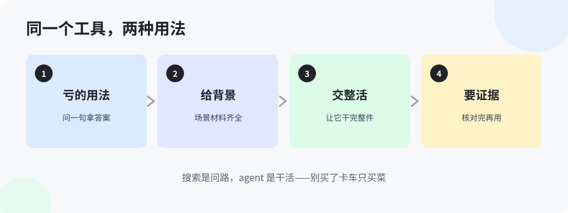

# 第 9 章 把 AI 当搜索引擎用，是最亏的用法（入门版）

> 这一章说一个让人心疼的现象：有人花大价钱买了最强的工具，回来只拿它查单词、问天气——就像买了辆卡车只拿它买菜。这一章把「亏」算给你看，再把同一个工具的两种用法摆在一起对比。

## 9.1 亏在哪

先算账。一个最强档的工具，一个月小几百块。它当搜索引擎用，一天回答你十个问题，每个问题省你两分钟搜索——一天省二十分钟。再看它当干活的用：整理一份三个月的聊天记录，你自己干要两天，它两小时；验一个版本，你大半天，它并行跑完出报告。**同样一个工具，用法不同，产出差几十倍。** 亏的不是钱，是你以为自己「已经用上 AI 了」，实际上只摸到了它最浅的一层（还记得第 2 章的三级台阶吗？这就是只站第一级）。

还有一层更隐蔽的亏：**当搜索引擎用，练不出任何本事。** 问答是一锤子买卖，问完就完。干活不一样：派活要说清、验收要判断、出错要定位——每一件都在练你的判断。一个月下来，当搜索引擎用的人，手感还是零；当干活用的人，已经能带着它跑流程了。

## 9.2 同一个工具，两种用法

拿一件真事对比——整理一份项目问题清单：

| | 用法 A：当搜索引擎 | 用法 B：当干活的 |
|---|---|---|
| 怎么开头 | 「问题清单应该包含哪些字段？」 | 把三处来源的原始记录全给它：「按项目去重归类，字段用这十列，拿不准的标出来」 |
| 得到什么 | 一段通用建议，还得自己动手整理一下午 | 一份整理好的清单，你只核对增删 |
| 中间互动 | 没有中间，问完结束 | 它标出 5 处互相矛盾的记录，你逐个拍板；它按你的拍板出终版 |
| 留下什么 | 一段聊天记录 | 清单本身 + 一套下次可复用的整理规矩 |
| 你的收获 | 知道了一个「应该」 | 练了一次派活、验收、拍板的全流程 |

差别不在工具，在你给它的东西：**用法 A 给它一个问题，用法 B 给它材料、标准和拍板权边界。** 它能干多大的活，取决于你敢把多完整的一件事交给它——当然，交给它的前提是第 1 章那三句：交代清楚、自己核实、写下来。

## 9.3 一句自查

以后每次打开 AI，先问自己一句：**我这次是来问个答案，还是来交一件活？** 问答案没错，每天都有要问的；但如果一周下来全是问答案、没有一件整活，你就是在拿卡车买菜。这一句自查，就是入门版和强化版的分界线：能稳定交活的人，可以进强化版了。

> **想一想 1**：同事说：「我天天用 AI，比他们用得勤。」你想判断他用得深不深，只需要问他一个什么问题？（答案在 `答案/入门版答案.md`）
> **想一想 2**（思维训练）：为什么「当搜索引擎用」练不出本事，而「交整活」能？差的到底是哪一步？（答案在 `答案/入门版答案.md`）
> **给 agent 的自查题**（发给你的 agent）：统计主人过去一周找你的次数里，「问一个答案」占几成、「交一件完整的活」占几成？如实报数，再给主人一个建议：下周哪件活适合整件交给你。

## 本章的活

回想你本周用 AI 最频繁的一次，把它归类：问答案，还是交活？然后挑明天的一件真活，故意按用法 B 走一遍：给材料、给标准、中间拍板、留下一套规矩。走完你就知道这一章在说什么了。
