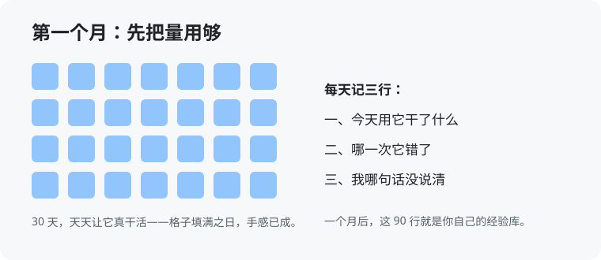

# 第 10 章 先把量用够（入门版）

> 这一章不讲新道理，讲练法。前面几章的道理，你可能点头，但脑子里没场景，挂不住——这不怪你，场景不是听出来的，是干出来的。这一章就一句话：**先把量用够，手感先于理论。**

## 10.1 每天 1 亿 token，坚持一个月

先说一个具体的练法：每天消耗 1 亿以上的 token，坚持一个月，不论什么形式，把这个量用够。一个月后，你的业务能力会上一个台阶，这本书再回头看，很多话就不用解释了。

1 亿听着吓人，先把它换算成人话。token 是 AI 读和写的计量单位，粗算下来，1 亿 token 相当于让几个 agent 替你连着干一整天的活。如果你在聊天框里一句一句地问，一年也烧不到这个数；让它交成品、跑流程（第 2 章的第二、三级），一天烧到这个量是正常干活的样子。**所以这个数字真正的含义是：别再拿它当词典偶尔问一句，让它整天泡在你的活里。**

为什么先上量？学游泳的人先下水，学开车的人先上路——场景感、手感、判断，都是泡出来的。你现在觉得书里某些话「好像懂了又好像没懂」，缺的就是这个泡的过程。量够了，你自然知道它什么时候靠谱、什么时候在编、哪种活该怎么派——这些没法靠讲，只能靠量。

为什么是一个月？短了，活的种类覆盖不全；长了，没必要。一个月里你会遇上写材料、查问题、改东西、做汇报——岗位上常见的活基本都能轮一遍。轮完这一遍，你再看这本书，是拿自己的经历对答案，感觉完全不一样。

> **想一想 1**：同事说：「我每天也问 AI 几十个问题，怎么没觉得进步？」用本节的道理，你怎么回答他？（答案在 `答案/入门版答案.md`）

## 10.2 量要烧在真活上

上量不等于浪费。三条规矩，守住，量才值钱：

- **从工作里领活，不拿闲聊凑数。** 让它写十首诗，量烧了，手感一点没长；把本周的周报、纪要、排查、整理全交给它干，量和本事一起长。
- **整件交，别切成碎渣。** 不要只让它起个标题、改个句子——把一件完整的活连头带尾交给它，你验收成品。整件干，你才能练出「怎么派活、怎么验收」的全套手感，这正是第二级往第三级走的路。
- **烧完要留东西。** 每件干完的活，至少留下一样：一段好用的问法、一张清单、一个脚本、一行记录。量烧过去就没了，留下的东西才是资产——下个月的你，是站在这些东西上面干活的。

> **想一想 2**：下面哪种烧法是对的？A. 每天让它写十首诗，把量凑够；B. 把本周的周报、纪要、排查全交给它干，干完自己验收；C. 同一个问题换十种问法，问十遍。（答案在 `答案/入门版答案.md`）

## 10.3 每天记三行

量要烧，账也要记，不然烧完就忘。每天收工前记三行，花不了三分钟：

1. **今天用它干了什么**——一句话一件，列全。
2. **哪一次它错了**——错在哪、你是怎么发现的。
3. **我哪句话没说清**——回想今天它写偏、干偏的那几次，有几次是你没交代清楚。

第三行最重要，也最容易漏。人天然只记别人的错，但它干偏，一大半原因是你没说清——把这一行记满一个月，你的提问会脱胎换骨。一个月下来，九十行记录，就是你自己的经验库；往后团队评估用 AI 的水平看提问记录（共创机制里写了），你这九十行就是最实在的底账。

记在哪都行：一个文档、一个本子、发给自己的聊天窗口。只有一个要求：**当天记，隔天就忘。**

> **想一想 3**（思维训练）：三行里为什么要专门记「我哪句话没说清」，而不是只记「它哪里错了」？（答案在 `答案/入门版答案.md`）

> **给 agent 的自查题**（发给你的 agent）：帮主人算一笔账——过去一周，主人交给你干的活里，属于「交成品、跑流程」的有几件，属于「问一句答一句」的有几件？再从主人下周的工作里，挑一件最适合整件交给你的活，告诉他为什么是这一件。

## 本章的活

从今天起，两件事并行：第一，把手头最重复的一件活，整件交出去一次，你只验收；第二，开始记三行，先记满七天再说。七天后翻一翻这二十一行，你自己就能判断这个练法对你有没有用——不用等一个月，更不用听别人说。
