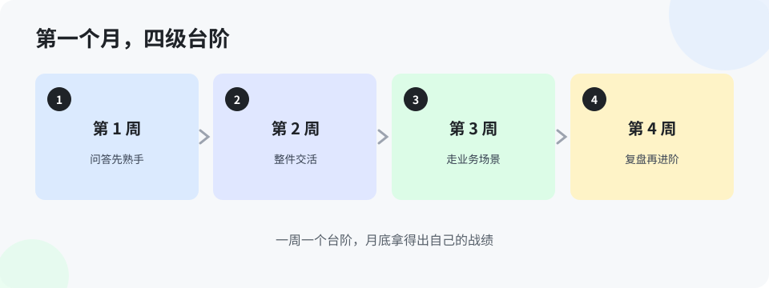

# 第 11 章 第一个月的周计划（入门版）

> 第 10 章定了总量：每天把量烧够，坚持一个月。这一章把一个月拆成四周，一周一个主题。别跳周——顺序是按「先易后难、先低风险后高价值」排的，跳着练，容易在难活上栽跟头，把信心练没了。

**第 1 周：办公场景全过一遍。**
目标：把第 7 章的十例，挨个在自己的真活上用一次。用不上的跳过，不许编场景。这一周只练一件事：派活时把要点说全。周末自查：十例用过几例？哪例省的时间最多？
风险提醒：这一周全是低风险的活，放心大胆用，错了也只是稿子重写。

**第 2 周：拿一件重复活练熟。**
从你的岗位里挑一件每周都要干的重复活——整理、汇总、对数、巡检准备，什么都行——这一周只攻它：把问法磨到稳定，把步骤写成一张单子，让它每次照单干。目标不是干一次，是干到「下周不用想，照单就能跑」。
周末自查：这件活的单子写出来了吗？换个同事照单子，能干吗？

**第 3 周：让它帮你查一次真故障。**
等一个真问题（或者翻一个最近的问题），按第 8 章例 1 的五样把材料备齐，让它出定位思路，你执行验证。不管最后查没查出来，把全过程记进三行：它的思路对了几步、错在哪步、你的问题说清了几样。
周末自查：五样齐了吗？它给的验证顺序，你执行了几个？

**第 4 周：做一件以前做不了的事。**
写个小工具、做个小插件、搭个自动整理的流程——选一件你以前因为「不会」而放弃的事。这一周允许慢，允许来回十几轮，目标是把它做出来。做出来那一刻，你对「横向延伸」四个字会有自己的理解，不用别人讲。
周末自查：东西做出来了吗？做出来，把用法写一句给同事；没做出来，卡在哪一步，记清，下个月第一周接着攻。

**验收（第 4 周末尾，加一件事）。**
这个练法到底有没有用，不用争论，用数说话：第 1 周结束时，把这一周你跟 AI 的交流记录收起来，按共创机制里那五样（问题说清没、先猜再问没、带证据没、追问准不准、结论落没落）打一个分，封存。第 4 周结束，再收一次记录，用同一把尺子打分。两个分摆在一起——如果这一个月的量真烧在活上，第 4 周的分数会明显比第 1 周好。好多少，就是这套练法在你身上的效果，一分不多，一分不少。
对带队的人也一样：想验证这套练法值不值得全队推广，不用开会论证，挑一个新员工认真跑一个月，两次打分就是结论。试点先行、用数验收——这本书教的方法，先用在它自己身上。

四周走完，回头看你的三行记录：大约九十行。这时候再问自己第 9 章那句——我是在问答案，还是在交活？答案会跟一个月前不一样。

> **想一想 1**：为什么周计划把「查真故障」放在第 3 周，而不是第 1 周就练？（答案在 `答案/入门版答案.md`）
> **想一想 2**：第 2 周的目标为什么是把单子「写出来」，而不是把活「干完」？（答案在 `答案/入门版答案.md`）
> **给 agent 的自查题**（发给你的 agent）：主人现在处在周计划的第几周？对照那一周的目标，他完成了哪几样、还差哪一样？把差的那一样拆成明天能动手的第一步，报给他。

## 本章的活

把四周的主题写进你自己的日历，每周留一个固定的半小时做周末自查。计划落到日历上才算数，光在脑子里排，等于没排。
