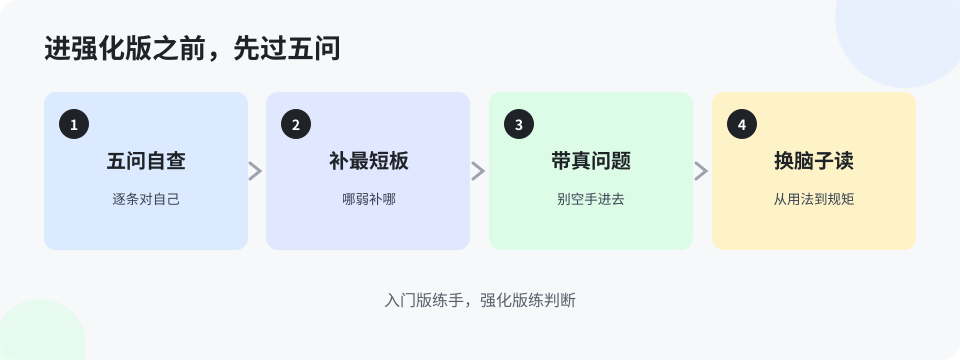

# 第 12 章 练完怎么进强化版（入门版）

> 入门版的最后一章，做两件事：给你一张毕业自查表，再告诉你强化版是本什么样的书、该怎么读。自查表过不了，别急着往后翻——不是你笨，是量还没烧够，回去把第 10、11 章的练法补满再来。

## 12.1 毕业自查五问

不用考试，自己对着问，答得干脆就是过：

1. 拿到一件新活，你能不能先说出「该找哪类工具、哪家的长板」？（第 4–6 章）
2. 派活之前，你能不能把要点、材料、标准一次说全，而不是挤一句问一句？（第 3、7 章）
3. 它给你的东西，你是不是每次都核关键的数和出处，而不是全盘照收？（第 1 章）
4. 你手头有没有至少一件重复活，已经变成「照单就能跑」？（第 11 章）
5. 你的三行记录，记满一个月了吗？翻回去看，你的提问是不是比第一周清楚了？（第 10 章）

五问里有四问答得干脆，入门版就算毕业。答不上来的那一问，就是你回炉的那一章——这本书的用法本来就是这样：不是从头读到尾，是哪儿缺补哪儿。

## 12.2 强化版的读法预告

强化版跟入门版是两种书。入门版教你**会用**，强化版教你**会判断、会组织**：问题为什么反复出、规矩怎么立、怎么把 agent 当下属管、碰到大事怎么一步一步跑通流程。读法也有三点不同：

- **不用通读，按需翻**。强化版是工具书：碰到返工，先翻第 2 章；要给 agent 立规矩，直接翻第 12 章。每章能单独成立，是故意这样写的。
- **每章多一块「给 agent 的话」**。那是把这一章的道理写成的规矩文件，你读完觉得对，就复制给自己的 agent 装上——从此它按这套方法替你把关。你读的每一章，都在给你的 agent 升一级。
- **问题在每节后面，答案在书末**。跟入门版一样，先想再翻。强化版的题更难：很多没有唯一答案，答案里给的是判断的顺序——先看什么、再看什么。学会顺序，比记住结论重要。

最后一句嘱咐：入门版练出来的是手，强化版练的是脑。手没练出来就啃脑，啃不动；脑跟不上，手练得再熟，也只是在第一、二层打转。两本书的顺序，就是这个道理。

> **想一想 1**：五问里，你最没把握的是哪一问？它对应回炉的哪一章？说出章号，就是答对了这一题。（答案在 `答案/入门版答案.md`）
> **给 agent 的自查题**（发给你的 agent）：陪主人对一遍 12.1 的五问。你的任务是当考官：每问请他举一个真实例子，举不出来的那一问，如实记下来，告诉他先回炉哪一章。

## 本章的活

认真对一遍五问，把结果写进三行记录的最后一页。然后做一件事：打开强化版目录，挑一章你最想看的，先把那章的「给 agent 的话」读一遍——你会发现，下一本书的用法，从这一块就开始了。
