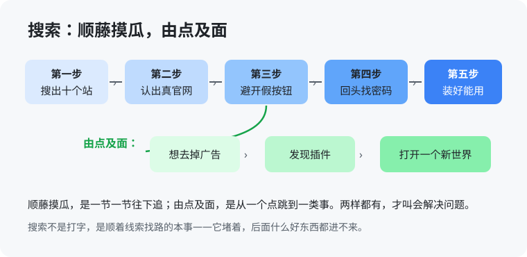

# 补章 你真的会用搜索吗？（入门版）

> 这一章补在正文之后，讲一件比所有工具都靠前的事：**搜索**。它看起来太基础了，基础到没人好意思说自己不会——但团队里真正的断层，恰恰就断在这里。搜索是自学的总入口，这个入口堵着的人，后面给他什么好东西，都进不去。

## 一个真事

最开始给大家做培训的时候，讲了一个工具怎么用，例子用的是人人都能碰到的国内工具，讲得也算细。过了一个半月，一个同事打电话来问：这个工具，怎么安装？

先别笑。培训讲的是「怎么用」，他卡在「怎么装」——装不上，前面讲的等于全白讲。更值得想的是这一个半月里发生了什么：他不是没遇到问题，是遇到问题之后，没有自己找办法的路，就这么拖着，拖到实在拖不下去，才打这个电话。

这不是他一个人的事。它敲的是一个警钟：**团队内部的信息差，正在变成断层。** 开会的时候，一个人说的话，另一个人已经听不懂了，又不好意思问——会很快开过去，活还能凑合往下干，于是「学不学都不重要」就成了不少人的心里话。断层就是这么形成的：不是谁不努力，是有人连找路的本事都没有，还以为大家都一样。

## 把一件小事走完：下载一个软件

就拿「下载并装好一个软件」这件最小的事，慢慢走一遍。条件对所有人都一样：同一台电脑，同一个百度，搜同一个名字。

- **第一步，认页面。** 搜出来的第一页，一大半是广告和假下载站。会的人先扫一遍：哪个是官网、哪个是「高速下载器」的套路；不会的人点第一个，装回来一整套全家桶。
- **第二步，认按钮。** 进了真官网，页面上有五个「下载」，四个是广告位，真的那个往往最不起眼。这一步靠的不是知识，是见过一次的经验。
- **第三步，找密码。** 下下来是个压缩包，解压要密码。密码通常就写在下载页的说明里，或者压缩包的注释里。卡住的人直接放弃；会的人回头把页面再找一遍——信息就在那儿，看你会不会回头。
- **第四步，去勾选。** 安装过程里藏着捆绑选项，勾要一个一个去掉。装完能打开，这件事才算完。

这一串动作，没有一步需要天赋。它难住一大批人的原因只有一个：没人带他完整走过一遍，他自己也没花过心思琢磨过。而走过一遍的人，收获远不止「会装软件」：他为了去掉那些广告，会去找去广告的办法；找着找着，发现了浏览器插件；插件一装上，是另一个世界——翻译、截图、各种小工具，从此他的浏览器跟别人的不一样了。**一件小事，就这么把思路打开了。** 没有这个环节、这个场景，普通人很难自己开窍——他又不是神仙。

很久以前，一个 QQ 群的公告写过一句话：「搜索，善用可以医愚。」这话听着有点狂，可你把上面这条链走完一遍就明白，它没说错：很多时候，人和人的差距，就差在会不会自己找路。

## 道理

1. **解决问题就两种本事。** 一是**顺藤摸瓜**：顺着眼前的线索一节一节往下追——页面不对就退回去换词，密码不在包里就在页面上，办法总在链条的下一节。二是**由点及面**：从一个点跳到一类事——会去广告，就知道有插件；会用一个插件，就知道有插件的世界；装过一次软件，就摸清了所有下载站的套路。只会顺藤的人，每次都是新问题，永远在爬链条；只会跳面的人，道理一堆，一个软件也装不上。两条腿都有，才叫会解决问题。
2. **不要重复造轮子，在今天要展开说。** 搜索时代有句话：你遇到的问题，别人大概率已经遇到过了，而且把过程和解法写在了网上，等你去参考、去抄作业。AI 时代更进一步：动手做一件事之前，先让 AI 去 GitHub 上看看，有没有现成的项目、现成的脚本，能顶掉你这件事的一部分。能拼现成的，就别从零写——省下的不只是时间，是整个开发周期里最贵的那部分压力。
3. **规范也是现成的轮子。** 行业里通行的规范、成熟的做法，就是前人造好的轮子，尽可能去遵循。这样一个团队做出来的东西才是一致的：这个功能和那个功能，交互一样、体验一样，不至于用户用着用着，像换了个平台。各自另创一套，暴露出来的问题会非常低级——低级到不该发生在一个干了几年的人手里。
4. **还有一种打法，叫大力出奇迹，要躲开。** 不找路，硬上：重装、硬啃、到处求人、拿时间堆。不是不行，是账难看——浪费的时间和金钱，全是自己的。用蛮力解决一次，下次还是同样的问题；顺藤摸瓜走通一次，这一类问题终身免疫。讨厌浪费生命的人，先戒蛮力。
5. **对带队的人多说一句。** 这种基础科普，不该靠谁嗓门大、耐心好，一遍遍用嘴讲——讲一遍，就该写成材料、做成单子、放进这本书这样的地方，让后来的人自己照着走、让各自的 agent 带着练。把人当复读机，才是真正的浪费。

## 怎么做

- **搜之前先想清要找什么**：官网、教程、还是某个具体问题的答案？对象不同，关键词完全不同。连要找什么都没想清就动手搜，是最常见的浪费。
- **第一页先扫，不要先点**：先认广告标记、认官网域名，再决定点哪个。多花十秒，省后面半小时。
- **卡住了先回头**：密码、说明、注意事项，八成在你已经打开的页面里，只是你滑过去了。回头看，比换十个关键词管用。
- **动手造之前，先找现成的**：让 AI 先去 GitHub 和网上把同类项目、脚本、方案过一遍，能顶一部分是一部分，验完了再决定自己写哪段。
- **做东西先对规范**：同类功能团队里、行业里通行怎么做，先看一眼再动手；你省下的每一次「另创一套」，都是在给产品攒一致性。
- **解决完多走一步**：问一句「这类问题，有没有一劳永逸的工具或办法」。插件、脚本、官方文档，都是这么被发现的——这一步，就是由点及面。

## 练一练

找一个你平时「都是别人帮你装、帮你弄」的小工具，今天自己从搜索开始，完整走一遍：自己搜、自己认页面、自己装。中间卡住的每个地方都记下来——每个卡点，就是你这条链上缺的那一节。走完再想一想：这条链上，哪一步能让你跳到一个「面」上去？

> **想一想 1**：培训讲完一个半月，同事打电话来问怎么安装。你判断：这是态度问题、能力问题，还是方法问题？依据是什么？（答案在 `答案/入门版答案.md`）
> **想一想 2**（思维训练）：「顺藤摸瓜」和「由点及面」，分别对应下载故事里的哪几步？只会其中一样的人，会卡成什么样？
> **给 agent 的自查题**（发给你的 agent）：复盘主人最近三次「找人帮忙才解决的小问题」：哪几次其实是他自己顺着搜索链条就能走通的？缺的是哪一节？把复盘报给主人，并给他排一个本周就能补上这一节的小练习。

## 本章的活

本周亲手装一个新工具，全程不求人。装完，把你的链条写成五步，发到团队里——你写的那一页，就是下一个同事的地图。下次再有人卡在同样的地方，让他先看这页，再开口问。
