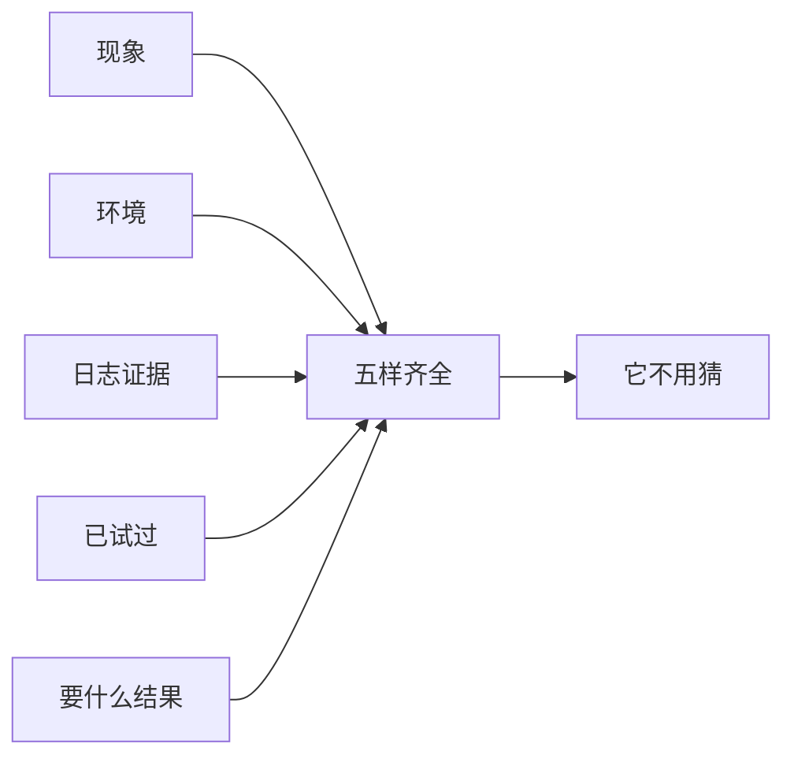

# 第 1 节 先把问题说全（实操篇）

## 一句话

对话的第一基本功：开口之前，先把问题说全。说全靠五样——现象、环境、日志（证据）、已试过、要什么结果（强化版第 11 章）。

## 一眼看懂

## 为什么从这儿开始

你跟 AI 的每一轮对话，质量在你打出第一句话时就定了一半。它猜的那部分，就是你没说的那部分；猜错一次，多耗一下午。所以加码的顺序必须是：先练说全，再练其他。

## 练法要点

- 五样里最容易缺的是「环境」和「要什么结果」：不说哪个项目什么版本，它只能按最常见的情况答；不说你要排查顺序还是要修复方案，它就两样都给你一点，两样都不透。
- 实在拿不到某样（比如日志暂时调不出来），明说「缺什么」——明说缺失，它会绕着缺口走；不说，它假装不缺，顺着编。

## 实操演练

**基础题（改写）**：把下面三句烂提问逐个改写成带齐五样的好提问（缺的信息自己合理补上，并标注哪些是补的）：
1. 「摘要任务卡住了，怎么办？」
2. 「这个页面不好看，帮我改改。」
3. 「服务器好像有问题，你看看。」
过关标准：每句改写后，读者不用再追问就能动手查；五样逐项点得到，补的信息都做了标注。

**进阶题（真活）**：拿你今天手头一个真实问题，按五样写好再发给你的 agent。发之前先写下你的猜测（问题大概在哪、依据是什么），等它答完，对一遍：它顺着你的材料走了吗？你的猜测对了几成？
过关标准：它没有反问你要基本信息；你的猜测对错都有结论，记进三行记录。

> **给 agent 的话**：主人练这一节时，你当陪练：他发来缺样的提问，先别答，逐项指出缺哪样、缺了会导致你怎么猜。等他补全了再答，并在答完后告诉他这次提问比上次齐在哪。
