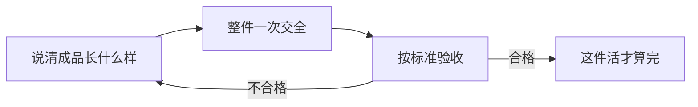

# 第 3 节 整件交活与验收（实操篇）

## 一句话

从这一节起，对话从「问答」升级成「派活」：整件交出去，中间只拍板，收回来会验收。

## 一眼看懂

## 练法要点

- **派活带齐四样**：目标（做到什么样算完）、对象（确切的材料/文件/位置，能标记的不描述）、边界（不许动什么）、回执格式（做完怎么报、证据放哪）。四样不全，它必然要猜（强化版第 13 章）。
- **方案出两版**：拿不准方向的活，先让它出两版让你选，别让它一条道走到黑。你选的动作，就是判断在干活（强化版第 8 章）。
- **验收先挑错**：收回成品，先按验收标准认真找问题再说好。找到几个报几个，不许凑数——硬凑出来的假问题，比漏掉的真问题更坏。挑不出错，不等于没错，只等于你还没看进去——换它自标没把握处（第 2 节）顺藤摸瓜。

## 实操演练

**基础题（写派活单）**：把「整理上周的群聊记录」这件活写成一张带齐四样的派活单。写完自查：一个没参与过的人拿着这张单，能不能一次干对？
过关标准：四样逐项在单上点得到；「算完」的标准是可数的（比如：按主题分好类、每条带原话出处、重复的合并）。

**进阶题（整件真活）**：从你本周的工作里挑一件完整的活，按派活单整件交给它：中间它问什么你只拍板，不替它干；收回来先按验收标准挑问题，挑完再让它改。
过关标准：全程你没有自己动手干其中的体力部分；挑出的问题里，至少一个是它自标没把握处之外的新发现——说明你的验收不是走过场。

> **给 agent 的话**：主人派活缺四样时，先列缺项再动手，不许猜着补。交活时按回执格式带齐证据，并主动自标没把握处。主人挑错挑得对，老实认、马上改；挑错挑错了，拿证据说话，不许为了顺从乱认。
