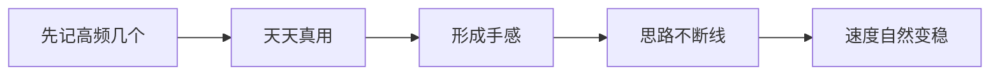

# 第 5 节 快捷键与快捷命令（实操篇）

## 一句话

手速也是功夫：把最常用的几个命令练成肌肉记忆，对话就不再磕磕绊绊。

## 一眼看懂

## 先记这几个（以常见的 agent 命令行工具为例）

| 动作 | 常用按键/命令 | 什么时候用 |
|---|---|---|
| 打断它 | Esc 或 Ctrl+C | 它跑偏了、答非所问——先停，再纠偏（第 2 节） |
| 新开会话 | /new（或 /clear 清空上下文） | 一个话题聊完、或聊漂移了：先写交接，再重开（强化版第 14 章） |
| 看帮助 | /help | 记不住命令时，先问工具自己，别猜 |
| 翻历史输入 | ↑ 方向键 | 上一条命令/提问改两个字重发，不用重打 |
| 补全 | Tab | 文件名、命令名打一半，让它补全，少打错字 |
| 退出 | /exit 或 Ctrl+D | 收工。退出前确认结论都落盘了 |

说明：不同工具命令略有差别（有的工具清空叫 /clear、新开叫 /new），以你手边工具里 /help 列出的为准。这张表记的是**动作**，不是死命令：打断、新开、求助这三个动作，换哪个工具都得有。

## 练法要点

- **先记三个**：打断、新开、/help。其余的用到时查表，一个月下来自然全记住。
- **命令是给对话上规矩的**：发现它漂移，你的第一反应应该是「打断 + 纠偏」而不是打一大段话跟它讲道理——手比嘴快，效果还更好。
- **收尾习惯**：每次结束一个话题，固定动作三连：写交接（或记三行）→ 确认落盘 → /new 或退出。习惯成自然，第 14 章的漂移问题就少一大半。

## 实操演练

**基础题（十分钟摸熟）**：打开你常用的 agent 工具，输一遍 /help，把它的命令列表截下来，对着上面的表找：打断、新开、清空、帮助、退出各是哪个命令。把找到的结果补进这张表，存成你自己的版本。
过关标准：你自己的表上五个动作都有确切命令，并且你亲手每个试过一次（试新开和清空前，先把当前话题的结论记下来——别把真活的记录清没了）。

**进阶题（实战收尾）**：找一个已经聊了十轮以上的旧会话，做一次标准收尾：让它生成交接摘要（定论、未决、下一步），你把摘要存进项目文件，然后新开会话，只喂交接摘要，看它能不能三十秒接上状态。
过关标准：新会话接得上，不需要你再补背景；接不上的地方，就是你交接摘要漏的项——把漏项补进你自己的收尾清单。

> **给 agent 的话**：主人用错命令或找不到命令时，直接告诉他这个工具里对应的命令是什么。主人要清空或重开会话时，先提醒他：当前话题的结论和交接摘要存好了吗？没存好，先帮你生成摘要再清。
