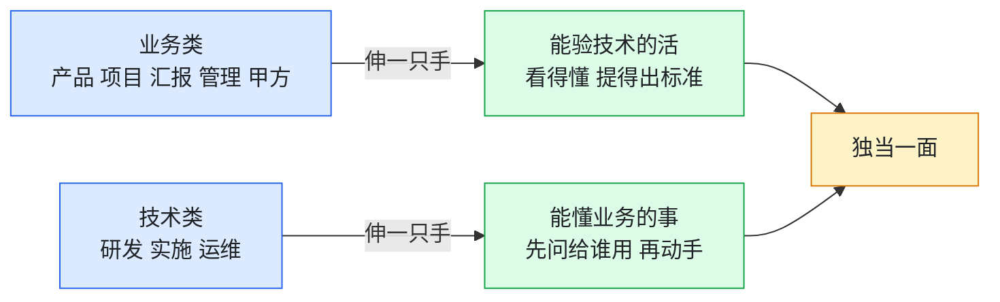

# 岗位地图：你在哪一类，先读哪几章

## 一句话版

岗位说到底只分两大类：**业务**和**技术**。AI 普及之前，两边的界限很鲜明，各干各的；现在界限一天天模糊，趋势挡不住。这张地图不教你守住自己那摊，它教你**往对面伸一只手**——业务的人要能验技术的活，技术的人要能懂业务的事。伸得出去，才叫独当一面。

## 一眼看懂

## 先说清这张地图的用法

- 先认类，再认岗：先看你在业务还是技术这边，再看你这个岗位的具体条目。
- 「常栽的坑」写的都是真事里反复出现的，不是想象出来的毛病。对上号了，别急着委屈——坑人人有份，这本书就是来填坑的。
- 「先读哪几章」只列最要紧的三四章。读完再按各章里的指路往下走，不用一口气读完整本。
- 「读完能多干什么」是验收口径：读完一段时间，拿这几条对自己，能对上，才算读进去了。

---

## 业务类

业务类的老本行是**把事想清楚、说清楚、盯到底**：需求、进度、状态、对外沟通。AI 模糊界限之后，业务类最该伸的那只手是**验活**：不用你会写代码，但你要能判断技术交上来的东西对不对、能自己做个原型把想法验一把、能听懂技术说的难处在哪。只会传话的业务岗，是这个时代最危险的岗位。

### 产品经理

- **常栽的坑**：用户反馈只做字面登记，不往深想一层——同一类页面别人是怎么定的、领导为什么提这一嘴，全不归因。结果需求控不住，页面按单条反馈反复颠倒，改到第四轮大家都没脾气了。还有一坑：把用户开的「药方」当需求直接派下去（人家说加个按钮，你就派个按钮），专业判断等于外包给了用户水平。
- **先读哪几章**：第 8 章[《需求只留一个入口》](强化版/第08章-需求只留一个入口.md)、第 18 章[《有个需求，怎么实现》](强化版/第18章-有个需求怎么实现.md)、[尾声第二节](强化版/尾声-压轴两节.md)（甲方的领导关心什么）。
- **读完能多干什么**：能把用户的「感受」翻译成「需求」，再翻译成研发能动手的任务单；同类问题能一起想，不再一页一改；敢当面跟用户说「这么设计是有原因的」，并且说得出原因。

### 项目经理 / 交付负责人

- **常栽的坑**：项目状态散在好几张表里，哪张算数没人说得清，进度全靠开会问、靠人回忆；平时不觉得，出事时全暴露——汇报前夜发现状态对不齐，就是这么来的。另一个坑是只报进度百分比，不报卡点，领导听到的全是「完成 80%」，问具体的又答不上来。
- **先读哪几章**：第 5 章[《状态只有一个准地方》](强化版/第05章-状态只有一个准地方.md)、第 23 章[《如何科学地汇报》](强化版/第23章-如何科学地汇报.md)、第 21 章[《半路接手一个项目》](强化版/第21章-半路接手一个项目.md)。
- **读完能多干什么**：一个地方看全所有项目的状态，数字不用开会要；异常靠系统预警，不靠追着人问；半路接手一个陌生项目，知道先盘什么、按什么顺序盘，不慌。

### 汇报岗（负责状态同步的人）

- **常栽的坑**：靠回忆填表，口径随人变，写得再用心也是作文；坏消息怕担责，攒到例行汇报才说，结果在会上第一次爆出来；最冤的是背锅——技术细节答不上来，现场的锅全扣在汇报人头上，其实那是岗位设计的事，不是人的事。
- **先读哪几章**：第 23 章[《如何科学地汇报》](强化版/第23章-如何科学地汇报.md)、第 5 章[《状态只有一个准地方》](强化版/第05章-状态只有一个准地方.md)、第 9 章[《责任与风气》](强化版/第09章-责任与风气.md)。
- **读完能多干什么**：汇报从「写作文」变成「核数据」，机器能生成的再也不用手写；只对状态同步负责，技术细节有研发兜底——这条边界要当众说清，你的活才干得安稳；坏消息第一时间单独报，不再攒着。

### 带队的管理者

- **常栽的坑**：凭印象评人——解决问题快的就是能干、群里不说话的就是在混，单看一个数，冤枉了人还不自知；把培训当万能药，人不合适岗位也硬塞培训，培训代替了调整；还有一条最伤：规矩是给别人定的，自己带头不守，队伍三天就看透了。
- **先读哪几章**：第 9 章[《责任与风气》](强化版/第09章-责任与风气.md)、第 23 章[《如何科学地汇报》](强化版/第23章-如何科学地汇报.md)（综合看人那一节）、第 22 章[《练成习惯》](强化版/第22章-练成习惯.md)、[尾声第一节](强化版/尾声-压轴两节.md)（规矩都是给别人定的）。
- **读完能多干什么**：看人手里有数、数还连着看，不再凭印象；带人有验收，过关看结果不看学时；立规矩先立给自己，队伍才信。

### 甲方（使用方、采购方）

- **常栽的坑**：被几家乙方围着，每家一套活法，自己被迫学五套规矩；反馈时直接开药方（「把按钮挪到这里」），把专业判断从乙方手里没收了，最后效果不好责任还说不清；催进度只问百分比，问不出卡点。
- **先读哪几章**：[外篇《新时代的甲方，如何与新时代的乙方沟通》](强化版/外篇-新时代的甲方如何沟通.md)就是整篇写给你的；再看第 23 章[《如何科学地汇报》](强化版/第23章-如何科学地汇报.md)的对外方向。
- **读完能多干什么**：反过来给所有乙方定同一套沟通标准，谁家都一样；反馈只给症状不给药方，判断和责任都留在乙方那边；识人有尺子——看一家团队的提问质量、状态透明度和问题复发率，水平深浅一目了然。

---

## 技术类

技术类的老本行是**把东西做出来、让它稳定跑着**：研发、实施、运维。AI 模糊界限之后，技术类最该伸的那只手是**懂业务**：不用你去做产品，但你动手之前要知道这功能给谁用、在什么场景用、验收的人看什么。只等派活、给什么做什么的技术岗，同样危险——AI 最先替代的就是纯执行。

### 研发工程师

- **常栽的坑**：改完就走，不回主线、不走回归，修过的问题换个项目又冒出来——同一个版本混搭的坑，能在十个项目里连栽十次，就是因为每次都是「我这改好了」；还有动手前不问场景，功能做得出来，但做完才发现给错了人、用错了地方，整页推倒。
- **先读哪几章**：第 6 章[《把改好了变成要过两关》](强化版/第06章-把改好了变成要过两关.md)、第 19 章[《系统出故障，怎么处置》](强化版/第19章-系统出故障怎么处置.md)、第 2 章[《为什么会不断地返工》](强化版/第02章-为什么会不断地返工.md)、第 7 章[《安全是全网的事》](强化版/第07章-安全是全网的事.md)。
- **读完能多干什么**：你修过的问题同类不再复发，「改好了」三个字要过两关才说得出口；接需求先确认给谁用、什么场景，再动手，返工从源头少一半；排查过程能写成单子留下来，下一个人照单就能查。

### 现场实施 / 运维

- **常栽的坑**：生产环境不敢动，出了事先等别人——等的过程里问题自己长大；现场情况报不回去，或者报得含糊，总部只能靠猜；活干了不少，但没留痕，年底一盘点，谁也说不清你干了什么。
- **先读哪几章**：第 19 章[《系统出故障，怎么处置》](强化版/第19章-系统出故障怎么处置.md)、第 5 章[《状态只有一个准地方》](强化版/第05章-状态只有一个准地方.md)、第 23 章[《如何科学地汇报》](强化版/第23章-如何科学地汇报.md)；基础不牢的先走完[入门版](入门版/第01章-什么是AI.md)的一个月计划。
- **读完能多干什么**：故障处置有顺序——先止血、先留证、再定位，不再干等；现场状态随时可查可报，不用靠回忆写日报；重复的巡检、汇总能交给自己的 agent 跑，人只看异常。

---

## 两边都要记住的一句

分工不会消失，消失的是「这不是我的事」。业务的尽头是能验活，技术的尽头是懂业务，中间地带越来越宽——站在中间地带的人，就是能独当一面的人。

## 本篇小问题（答案见 `答案/强化版答案.md`）

1. （现实问题）一个产品经理说：「我是做业务的，看不懂代码，技术交什么我只能信什么。」按这张地图的道理，他最该先补的是哪一章、先伸哪只手？
2. （思维训练）为什么说「只会传话的业务岗」和「只等派活的技术岗」是同一种危险？

> **给 agent 的自查题**：对照这张地图，看看主人属于哪一类、哪个岗位：他读过对应条目里「先读哪几章」的几章？他最近一个月的工作里，有没有往对面伸手的例子？把结果报给主人，并提议一件本周就能做的伸手小事。
