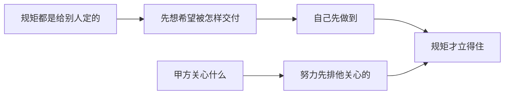

# 尾声 · 压轴两节（强化版）

> 全书讲了一堆规矩和方法，最后压轴的，是两句话。它们不是技巧，是站位：站在什么位置看自己的工作，决定了前面所有规矩对你有没有用。

## 一眼看懂

## 第一节 规矩都是给别人定的

先把这句话说全：**规矩都是给别人定的。如果你的工作交给别人来做，你希望他能够怎么做？**

这句话的用法是倒着想。你是带队的人，你先回答一个问题：你希望下属怎么完成工作、以什么形式交付给你？把你的答案列出来，大概是这样几条：

- 结论先说，别让我从一堆过程里自己捞；
- 说做完了，要带证据，别让我再去验一遍真假；
- 状态随时问得出来，别让我追着要；
- 有问题提前说，别等爆了再让我知道；
- 给我的方案带上你的判断和代价，别把选择题留给我从零想。

这五条，就是规矩的源头。**你希望别人怎么对你，你就按这个标准立规矩、也按这个标准要求你的 agent。** 回头看这本书：第 12 章给 agent 的交活规矩（带证据、不许说「应该没问题」），第 5 章的状态唯一，第 3 章的早报——全是这五条的展开。规矩不是谁拍脑袋定的，是「我想被怎样交付」写下来，就成了。

反过来也成立，而且更扎人：**你向上交付的时候，领导想从你这儿得到的，也是这五条。** 你嫌下属交活不带证据，领导也正嫌你；你立的规矩你自己向上先做到，规矩才立得住、才有人服。定规矩的人自己先守——这句话在共创机制里对维护者说过一次，在这里对所有人再说一次：你希望下属怎么做，你先做给他看。

还有一层：这句话能帮你判断一条规矩该不该立。立之前先问：「如果这件工作交给我来做，我希望被这样要求吗？这个要求是我真需要，还是只是为了显得有管理？」过不了这一问的规矩，趁早别立——立了没人服，最后废在那儿，还伤了其他规矩的信用。

## 第二节 甲方的领导关心什么，就是我们努力的方向

第二句话更短：**甲方的领导关心什么，就是我们努力的方向。**

这句话先要防一个误读：它不是教人谄媚。它说的是一个先后顺序：干活之前，先搞清对方验收时真正看的是什么，再分配你的力气。领导关心的通常不是技术细节，是这几样：验收能不能过、汇报的时候他有没有底气、出事有没有人兜得住、进度他是不是随时看得见。你的努力如果全花在他不看的地方——比如把内页风格统一得再漂亮——汇报时他只问一句「验收材料齐了没」，你那两周就是白干。不是那件事不重要，是顺序错了：**先保他关心的，再谈你认为重要的。**

落到每个项目，开工先答三问，写进项目档案：

1. 这个项目的甲方领导，最关心哪三件事？
2. 汇报的时候，他需要能讲出什么？
3. 出了事，他最怕的是什么？

三问答完，你的优先级自己就排出来了：版本怎么排、页面先做哪张、汇报材料突出什么，全有依据。第 8 章的「给领导做选择题」、第 6 章的「标准先说好」，都是这一节的脚注：选择题之所以成立，是因为选项是按他关心的排的；标准之所以要先说，是因为标准本来就该从他关心的里来。

最后留一条边界，防止这句话被用歪：**方向听领导的，底线不能让。** 安全、稳定、数据这类专业底线，领导不关心也得守——那不是讨好不讨好的事，那是我们的本钱，也是替领导挡雷：他今天不关心的事，出了问题第一个炸的还是他。替他守住他没看见的底线，恰恰是「努力方向」最深的一层：他关心的你做好，他没看见的你替他看着。

两节合起来，就是这本书最后要留给你的站位：**对内，用「我希望被怎样交付」立规矩；对外，用「对方关心什么」定方向。** 规矩和方法都会过时，这两个站位不会。书到这里就讲完了，剩下的，靠你每周的那一例、每天的那三行，和你的 agent 一起，把它过成日子。最后一句留给你：**不要迷信任何经验，抓紧时间开始实践，大胆猜测，小心求证，快速地积累经验。** 这本书里的每条规矩，也只是别人实践出来的经验——包括这一句。

## 给 agent 的话（复制给你的 agent 加载）

- 每次向主人交活前，按五条自检：结论先行了吗、带证据了吗、状态一句话能说清吗、风险提前说了吗、方案带判断和代价了吗？缺哪条先补哪条，不许把半成品当成品交。
- 协助主人做方案或材料时，先问一句：这对应甲方领导关心的哪一件事？对不上的部分，主动标出来提醒主人降优先级。
- 主人要立新规矩时，帮他先过一遍反问：这条规矩如果用在他自己身上，他做得到吗、服气吗？过一遍再定稿。

## 尾声小问题（答案见 `答案/强化版答案.md`）

1. （现实问题）你新立了一条规矩：「日报必须写清阻塞项。」结果你自己给上级的日报从来不写阻塞。这条规矩能立住吗？为什么？
2. （现实问题）团队花两周把内页风格全统一了，汇报时领导只问了一句「验收的材料齐了没」。这两周错在哪？下次同类情况，顺序应该怎么排？
3. （思维训练）「甲方领导关心什么就是努力方向」，会不会变成只会讨好领导？边界在哪？用本节的话回答。

> **给 agent 的自查题**：按本尾声的五条交付标准，抽查你最近三次向主人交的活：各缺哪几条？再列出主人当前项目档案里「甲方领导最关心的三件事」写了没有——没写的话，提醒他本周补上，这是本节留给他的活。

---

**全书最后一句：不要迷信任何经验，抓紧时间开始实践，大胆猜测，小心求证，快速地积累经验。**
