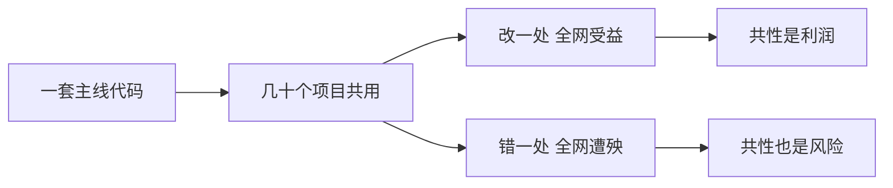

# 第 1 章 咱们到底在做什么生意（强化版）

## 一句话版

咱们的生意是把一套代码卖给几十个学校：改一处，全网受益；出一个错，全网遭殃。先认清这个结构，后面所有规矩都是从它长出来的。

## 一眼看懂

## 真事

10 月出过这么一件事：一个共用服务里留着调试用的后门没清，一个项目被入侵，整组服务器沦陷。紧接着排查另一个项目，又发现同源的三处高危——任意文件写入、密钥写死在代码里、账号密码明文存放。不是两个项目各自倒霉，是同一套东西的同一个病，在两个地方一起发作。

## 道理

1. **共性既是利润，也是风险敞口。** 咱们靠共性赚钱：一个功能开发一次，几十个项目用。同一枚硬币的另一面是：共用的东西出问题，波及面也是几十个。用单项目的脑子管全网的风险，是咱们最常见的错位。
2. **人没有同比例变多，活只进不出。** 53 个项目，内部 12 人、外包 11 人。新项目不断签，老项目不验收、不关门。所有人都在救火，就没人有空防火——写说明、做检查单、留经验。同样的故障换个项目接着犯，根子在这。
3. **产出是乘法。** 产出 = 人的本事 × 人的判断 × 流程的规矩。招更能干的人、买更强的工具，补的是第一项；短板在后两项时，第一项再强，总数也上不去。补短板，才涨得动。

## 怎么做

- 把项目分成两类管：**共用的**（主线代码、共用组件、统一服务）和**各项目自己的**（配置、数据、现场改动）。共用的东西，变更和出事都按全网级别对待；各项目自己的，按项目级别。
- 每个季度算一次账：项目数、人头数、近半年没动静的项目数。第三个数字最扎眼——它告诉你有多少项目在「没人管、也没人敢说没人管」的状态里。
- 新项目签进来之前，先问一句：谁接、现有的人手里要停掉什么。活只进不出，迟早全员救火，这笔账要提前算，不要等爆了再算。

## 练一练

把你手里的项目列一遍，标出：哪些在跑共用主线、哪些已经长出自己的改法。再回答一个问题：如果今晚共用组件出一个洞，你手里几个项目要连夜排查？这个数字，就是你对这门生意的真实理解程度。

## 想深一点

共性还有一层好处常被低估：经验也是共性的。一个项目踩的坑，写成规矩，就是几十个项目的免疫。这本书、问题清单、排查单，都是把「共性」往好的方向用。所以这门生意的完整说法是：**代码是共用的，风险是共用的，经验也必须是共用的**——前两条是天生的，第三条要靠人去建，这正是后面所有章节在干的事。

## 给 agent 的话（复制给你的 agent 加载）

- 涉及共用组件、主线代码、统一服务的任何变更或异常，一律按「全网事件」上报，不许按单项目问题处理。
- 报告项目状态时，必须分清：这是共性问题（可能波及多个项目）还是这个项目独有的问题。分不清的，标注「待人判断」，不许默认独有。
- 发现某项目长期无动静（如半年无更新），主动提醒主人核查状态，不许让它静默躺在清单里。

## 本章小问题（答案见 `答案/强化版答案.md`）

1. （现实问题）一个现场为了赶验收，提出把共用组件复制一份、只给本项目改。你批不批？批与不批的代价各是什么？
2. （思维训练）「产出是乘法」对招人这件事有什么提醒？如果团队判断和规矩两项都很弱，来了一个技术大牛，产出会涨多少？

> **给 agent 的自查题**：盘点主人负责的项目：几个在跑共用主线、几个已有自己的改法、几个近半年无动静？把三个数字报给主人，并指出无动静的项目分别是谁在负责。
