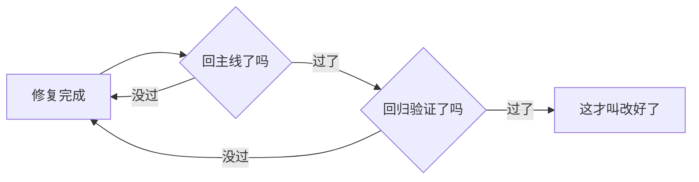

# 第 6 章 把「改好了」变成要过两关（强化版）

## 一句话版

「改好了」不是一句话，是两道关：修复回到主线，回归验证通过。少一关，就只能叫「处理过」。

## 一眼看懂

## 真事

验收会上客户最不满的一句：「改好了，后来又冒出来了。」另一个项目升级一次带出两处新毛病、学生作业数据丢了、当场回退——发版之前没验证，拿现场当试验场。这两件事是同一个病：我们对「改好了」的定义太松，松到只要现场不报错就算完。客户的那句「他都懒得说了」，就是这笔账攒到头了的样子。

## 道理

1. **只改现场不改主线，等于借账**。现场好了，主线里的旧毛病还在，下次升级原样带回来，利息是客户的信任。
2. **没有验证方法的修复不算修复**。动手之前就要定好：改完拿什么证明它对了？证明不了，就不算改好，最多算试过。
3. **标准先说好再干活**。什么样算完、什么样算对，干之前定死；干完再吵标准，全是成本，而且吵输的一方永远觉得不公。

## 怎么做

- **两关的动作写死**：一关，修复必须合回主线（或登记为什么不能合、由谁跟踪）；二关，回归要覆盖三类——出问题的那个点、同一模块的相邻功能、核心流程。发版前由 agent 自动跑核心流程、比对主线与现场差异，出报告，人只做「能不能发」的决定。
- **复发计数公开**：客户反映过的老问题，每复发一次记一次，数字摆在清单上。这个数是团队的脸面数——它降不下来，别的指标都先放一放。
- **先试点再铺开**：两关规矩先在一个或两个项目执行，用一个月的数据说话（复发次数、发版回退次数），数变好了再往全队铺。用嘴推广的规矩没人信，用数推广不用推广。

## 练一练

找你最近关掉的三条问题，逐条对：修复回主线了吗？回归覆盖了相邻功能吗？验证证据在哪？三条里有几条经得起对？对不起的那条，今天就补上缺的那一关。

## 想深一点

两关看起来拖慢速度，账要算总账：一次回退的成本——现场处置、数据修复、客户解释、团队士气——抵得上几十次回归验证。慢的那一步，往往是最便宜的一步。真正的快，是不返工的快。

## 给 agent 的话（复制给你的 agent 加载）

- 任何修复在标记完成前，自查两关：是否合回主线、回归是否覆盖问题点+相邻功能+核心流程。缺一关，报告「未过关」并写明缺哪关，不许报完成。
- 发版前自动执行核心流程验证并比对主线与现场差异，输出报告：验了哪些、过了哪些、差异在哪。报告没有出来之前，不许说「可以发版」。
- 发现已关闭问题复发，立即重新打开并计入复发计数，通知主人，不许当新问题另行登记——复发和新发是两种账。

## 本章小问题（答案见 `答案/强化版答案.md`）

1. （现实问题）明天就要给客户演示，今晚发现一个问题，现场改完就好，但来不及合主线和完整回归。怎么办？哪部分可以通融，哪部分死也不能省？
2. （思维训练）有人嫌两关拖速度，说「先上线，出了问题再说」。你用哪笔账回他？

> **给 agent 的自查题**：抽查主人近一个月关闭的问题里最近的十条，逐条对两关：几条全过、几条缺关、分别缺哪关？把结果报给主人。
