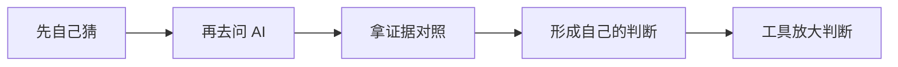

# 第 10 章 先修判断，再用工具（强化版）

## 一句话版

AI 是放大器，放大的是用它的人的判断。顺序不能反：先补判断和规矩，再上 AI 的规模。

## 一眼看懂

## 真事

同一套系统、同一个模型，不同的人用，产出天差地别。有人拿它一个下午搭出能跑的小工具，有人拿最贵的订阅只当搜索引擎（入门版第 9 章专门算过这笔账）。差距不在工具，在人：前者知道自己要什么、能验收，后者连问题都说不清。咱们团队还有一个现象：不少人对 AI 的全部使用，就是「把客户的话转述给它，再把它的输出转述给客户」——两头传话，中间没有自己。这种用法，模型再强也救不了。

## 道理

1. **判断力的核心动作是「先自己猜」。** 碰到问题，先把自己的判断和依据写下来，再看 AI 的。它对了，你的判断被验证；它错了，你能发现——发现错误的能力，就是判断力本身。顺序反过来，先看它的答案，你的判断就永远练不出来，最后变成它说什么信什么。
2. **职业素养的新定义，是横向延伸。** 以前素养是沟通礼仪那一套；现在是：用 AI 把自己岗位的边界撑宽——产品经理能写代码验证想法，售前能做 demo，运维和项目经理能写自己的插件。延伸不是为了抢别人的活，是为了跟 AI 对得上话：你亲手做过一遍，才知道这类活的难处和验收点在哪。
3. **人只干三件事。** 判断、拍板、跟人打交道。其余的查、比、记、盯，全力交出去。守不住这条分工，人就被重复活淹没，判断力反而越用越少——因为没时间想。

## 怎么做

- **先猜再问成为硬动作**：求助和提问之前，先写两行：我判断是什么、依据是什么。写不出来，说明你还没想——这时候去问 AI，问完把它的答案跟你的两行对一遍，对的过程就是练判断。
- **每人每季一件横向作品**：一个小工具、一个插件、一个自动化流程，不论大小，必须是自己岗位之外的一步。作品不评奖，只验收：能不能跑、省没省事。带队的人先交——这条跟第 9 章的风气是一根线。
- **验收能力单独练**：AI 交的活，先挑错再采用。每周挑一次它给的东西，专门找出三个问题（事实错、逻辑跳、没考虑现场）。挑错挑得准的人，用 AI 才安全。

## 练一练

回想你最近三次向 AI 提问：有几次是先写了自己的判断再问的？挑其中一次，把顺序倒过来重做一遍：先写判断，再让它答，对一遍差异。差异最大的那个地方，就是你判断力现在最薄的一块。

## 想深一点

判断力没法靠培训班速成，它只能靠「判断—验证」的次数堆出来。这正是入门版练法（先上量）的深层理由：量不只是练手速，是给判断提供验证的机会。所以两个版本是一套：入门版用数量堆验证次数，强化版用方法提高每次验证的质量。跳过入门版直接读强化版的人，道理都懂，就是没手感——道理挂不住，还是因为验证次数不够。

## 给 agent 的话（复制给你的 agent 加载）

- 主人提问前如果没有给出自己的判断，先提醒他补两行：我判断是什么、依据是什么。补完再回答。不许为了省事直接跳过——这是练判断的硬动作。
- 交活时主动标出你最没把握的三处，方便主人验收；不许把不确定的内容写得和确定的内容一样肯定。
- 每季度提醒主人盘点一次横向作品：本季做了什么岗位之外的东西？没有的，建议一件本周能起步的小事。

## 本章小问题（答案见 `答案/强化版答案.md`）

1. （现实问题）下属把客户的话原样转给 AI，又把 AI 的输出原样转给客户，全程没有自己的判断。你指出问题时，他说「结果不是挺好吗」。你怎么回？
2. （思维训练）为什么说「先看 AI 的答案」会让判断力退化？退化的是哪个具体能力？

> **给 agent 的自查题**：统计主人近两周的提问：几次带了自己的判断、几次是空手来问？把比例报给主人，并挑一条空手提问，示范补上「先猜」两行应该怎么写。
