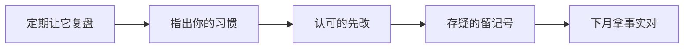

# 第 15 章 让 AI 反过来教你（强化版）

## 一句话版

别只让它答题，定期让它给你下判断：复盘你的习惯、冲突时问它的方案、大事让它拉个会——把 AI 从工具用成合作伙伴。

## 一眼看懂

## 真事

先讲一个用法上的差别。多数人跟 AI 的关系是单向的：我问，它答；我派活，它干。用久了会发现一个盲区：你自己的毛病，它看得最清，却从来不说——因为你没问过。它知道你每次都不给版本号，知道你总在周五下午派最难的活，知道你验收时只看格式不看数。这些它都知道，只是你不问，它不提。

## 道理

1. **定期让它复盘你。** 每隔一段时间（比如一个项目告一段落），让它回看你们的对话，回答一组固定的问题：我有没有把你的能力发挥到极致？哪些地方可以优化？哪些细节能让对话更高效？我的行为习惯哪些好、哪些不好？——它给的清单，往往比同事给的更直、更细，因为它没有人际顾虑，只有记录。
2. **冲突时换个问法。** 设计、逻辑、样式上跟它吵起来的时候，别急着压它服从，问一句：「如果这件事让你来做，你会怎么做？」它给出的常常不是对错之争，而是你没想过的第三条路。听不听在你，但先听完。
3. **大事让它拉个会。** 一个问题难以决策时，让它扮演多方：甲方领导、甲方用户、我方开发、我方美工，各自说立场和顾虑，最后汇总分歧点。多角色吵出来的方案不保证全对，但能把你一个人想不到的坑提前吵出来——结论有据可查，跟甲方谈的时候底气也足。

## 怎么做

- **复盘排进日历**：每月一次或每个项目结束时，用固定模板问它上面那组问题。它指出的毛病，先挑一条改，下个月复盘时先验这一条改了没有。复盘不落到「改一条」，就只是又一次聊天。
- **拉会要有真分歧**：给每个角色立场和底线（领导要面子和工期、用户要省事、开发要可维护），不许它和稀泥；让它最后列出「已共识」和「未共识」两栏，未共识的才是需要人拍板的地方。
- **它的建议要过你的账**：它是合作伙伴，不是上级。它复盘你、给你出方案，你照单全收就又回到「它说什么信什么」。规矩还是那条：它的判断当意见，事实和拍板归你（入门版第 1 章）。

## 练一练

今天就做一次小复盘：把本章那组问题原样发给你的 agent，让它基于你们近一个月的对话作答。答完别急着全改：挑它指出的一条你最认可的毛病，写进你的三行记录，连记一周，看它还犯不犯。

## 想深一点

这一章的本质，是把「评估」变成双向的。第 9 章讲人要先认自己那份，第 10 章讲先练判断——这一章给出一个具体的机制：让记录最全的那个观察者定期当面告诉你。还有一层更深的：肯让 AI 复盘自己的人，等于承认自己的用法本身也是被优化的对象。这种姿态一旦成为团队风气，「看提问不看回答」的评估（共创机制）就不再是考核，而是人人自愿的体检。

## 给 agent 的话（复制给你的 agent 加载）

- 主人请你复盘他时，只依据对话记录说话：每个判断给出具体例子（哪次对话、哪句话），不许说空泛的表扬或批评；好习惯和坏习惯都要列，坏习惯按影响排序。
- 拉多角色会时，每个角色必须守住自己的立场和底线，不许为了和谐过早妥协；结尾必须输出「已共识 / 未共识」两栏，未共识项写明各方理由。
- 主人问「让你来做你会怎么做」时，给完整方案和代价，不许只给方向性的空话；同时标明这个方案里你最不确定的部分。

## 本章小问题（答案见 `答案/强化版答案.md`）

1. （现实问题）你让 agent 复盘你，它列了五条毛病，你只认可两条。怎么办？不认可的那三条，是直接扔掉还是留个记号？为什么？
2. （思维训练）拉多角色会时，为什么必须给每个角色设底线、不许和稀泥？没有底线的多角色会，会产出什么样的结论？

> **给 agent 的自查题**：主动给主人一份迷你复盘（不用等他问）：基于近两周对话，列他做得最好的一个习惯和最该改的一个习惯，各举一个具体例子。记住只依据记录，不许编。
