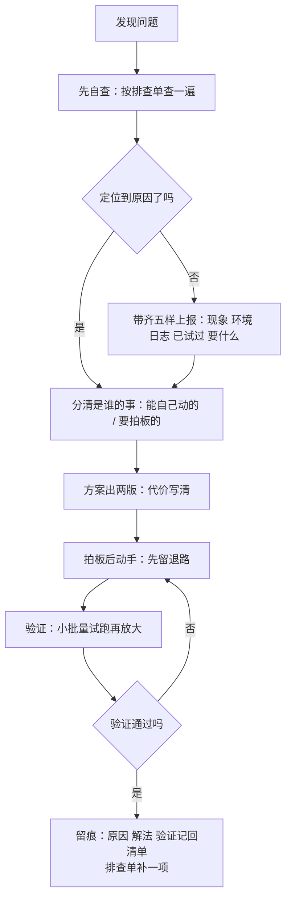

# 第 17 章 有个现实问题，怎么解决（强化版·全流程）

## 一句话版

碰到现实问题，按一条固定的链走：先看状态，再看数字；先定位，再动手；先分清是谁的事；方案出两版；动手前留退路；做完要验证；最后留痕。顺序不错，问题再大也不慌。

## 案例全程：5000 条摘要堵死那一次

某客户平台，摘要任务堵了 5000 多条，取消重做还是卡。现场第一反应是上报研发等发包——按老办法，这事至少耗一天，还不保证根治。按本章的链走一遍：

1. **先看状态**：这台机器什么版本、最近动过什么、队列服务在不在跑。不看状态就动手，等于蒙眼修车。
2. **再看数字**：堵了多少条、从几点开始堵、堵的速度还在不在涨。数字定了问题的大小和急迫程度。
3. **先定位**：按排查单分层——先查配置层。查到根子：一个模型被禁用了，摘要任务还在往它那儿投，投一个堵一个。不是代码坏了，是配置和状态脱节。
4. **分清是谁的事**：改配置，现场权限内能动；但要不要恢复那个模型、恢复哪个，是拍板的事，报上去定。
5. **方案两版**：A 版先把任务改投到可用模型，清存量，快，但要确认质量可接受；B 版等模型恢复再续跑，稳，但存量要压到晚上。代价写清，人拍板选了 A。
6. **动手与退路**：改投之前把原配置记下来，存量先备份队列清单——A 版不行，十分钟能退回原样。
7. **验证**：先放 50 条试跑，看产出质量和速度，再放全部；盯到存量清零、新增正常。
8. **留痕**：原因、解法、验证结果三行记回问题清单；排查单加一项：「任务大面积堵死先查目标模型/服务是否被禁用。」——下一次同类问题，任何人（和任何 agent）十分钟定位。

全程现场加 agent 干完，研发只参与了拍板那一步。这就是这条链的价值：不是某个人变厉害了，是顺序对了，谁走都走得通。

## 流程图

## 每一步谁干

| 步 | agent 干 | 人干 |
|---|---|---|
| 看状态、看数字 | 拉数据、比对历史、标异常 | 判断大小和急迫程度 |
| 定位 | 按排查单逐项查、出证据链 | 审证据、定方向 |
| 分工 | 标明哪些在现场权限内 | 拍板权限外的事 |
| 方案 | 出两版、列代价 | 选一版、担责任 |
| 动手验证 | 执行、试跑、盯指标 | 看验证结果、决定放大或回退 |
| 留痕 | 整理三行记录、更新排查单 | 审一眼、确认归档 |

## 本章小问题（答案见 `答案/强化版答案.md`）

1. （现实问题）半夜告警：某项目任务大面积堵死，你是值班的。按本章的链，你的第一步是什么？为什么不是先群里喊研发？
2. （思维训练）这条链里，「分清是谁的事」为什么排在定位之后、动手之前？顺序挪到定位之前会出什么问题？

> **给 agent 的自查题**：复盘主人最近处理的一个现实问题：对照本章八步，哪几步走了、哪几步跳了？跳过的步里，哪一步的跳过代价最大？报给主人。
