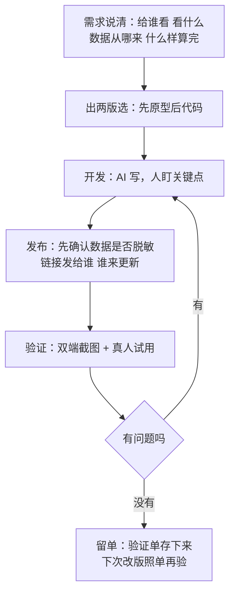

# 第 18 章 有个需求，怎么实现（强化版·全流程）

## 一句话版

有个需求要落地，走五步：需求说清、出两版选、开发、发布、验证。每一步都写清你跟 AI 怎么分工，卡住就回第 11 章的办法，不硬耗。

## 案例全程：自己做一个工具网页，并发布到外网

需求是这样的：想要一个小工具网页——把每周的项目状态汇总成一页，团队打开链接就能看，不用再翻六套表。干活的人不是专职开发，是项目经理本人。这正是横向延伸（第 10 章）的典型场景。

**第一步：需求说清（人主导，AI 帮着问）。**
先不过脑子写代码。把四件事说清：给谁看（团队内部，先不对外）、看什么（一页看清：项目、状态、超线项）、数据从哪来（先手工维护一份表，以后再谈自动）、什么样算完（手机上打开不费劲、链接能直接发群里）。说不清的让 AI 反问你——它问出来的问题，往往就是你没想到的坑。产出：一页纸的需求说明，存进项目文件。

**第二步：出两版选（AI 出版，人拍板）。**
让它出两个版式的原型：A 版是表格主导，信息全；B 版是卡片主导，状态和超线项突出。别让它直接写正式代码，先看版式。选版的标准不是哪个好看，是第 1 步那句「一页看清超线项」——B 版胜出。这一步省掉的，是做完才发现方向错的整轮返工（第 2 章）。

**第三步：开发（AI 干体力，人盯关键点）。**
它写页面代码，你盯三件事：数据是不是写死的（以后怎么更新）、超线项的判断规则对不对、手机上排版有没有挤。每完成一段，让它自己先跑一遍演示数据验证。人不逐行审代码，但每个关键点的判断必须过人——这是第 11 章「命令先看懂再上」在开发场景的版本。

**第四步：发布到外网（AI 给路径，人走审批和确认）。**
发布有现成的路子：静态页面可以挂在代码托管的页面服务上，也可以放一台有公网的服务器。让 AI 把两种路径的步骤和代价列清，你选一条；真正点「发布」之前，把三件事确认了：里面有没有不该公开的数据（内部版先只放脱敏的状态，不放客户名和细节）、链接发给谁、以后谁更新。发布动作由人确认，AI 不许自作主张把内部东西发到公网——这是第 12 章权限规矩的红线。

**第五步：验证（agent 先验，人抽查）。**
发布后让 agent 用手机和电脑两种尺寸各打开一遍，截图回来：排版、数据、链接都对不对。再发给两个同事试打开，收一轮真实反馈。小问题当场改，改完重复这一步。验证记录留下来——这个页面以后每次改版，都照这个单子再验一遍，它就成了这个小工具自己的回归单（第 6 章）。

全程一下午多一点。做完之后最大的收获不是这个页面，是干活的人从此知道：**需求类的事，流程对了，非专职开发也能端到端交付。** 这就是这本书要批量生产的能力。

## 流程图

## 卡住时怎么办

开发中卡住是常态，按第 11 章走：把卡点说清五样（现象、环境、报错、已试过、要什么），让它先分层定位；两轮不行就停，换思路——缩小需求（先上线最小版）、换工具、或者找人看一眼。最忌讳的是在同一个坑里跟它耗一下午，还觉得「快好了」。流程的价值就在于：每一步都有明确的产出，卡住时你清楚自己卡在哪一步、该退回哪一步。

## 本章小问题（答案见 `答案/强化版答案.md`）

1. （现实问题）做到第三步，它写的代码你大半看不懂，但跑起来好像是对的。你敢直接进第四步发布吗？哪几个关键点你必须先弄懂？
2. （思维训练）为什么「出两版选」要放在写正式代码之前？放到之后，多的成本是什么？

> **给 agent 的自查题**：回顾主人最近实现的一个需求：五步走了哪几步、跳了哪几步？跳步的那次，后来有没有为跳步付出返工？如实报给主人。
