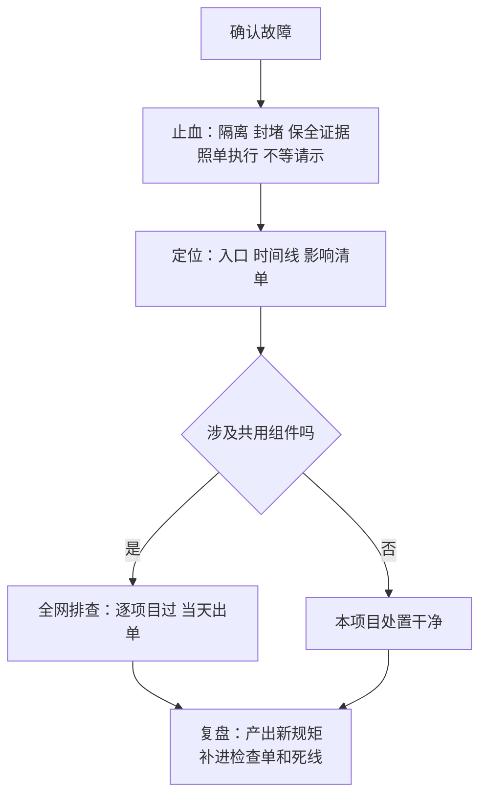

# 第 19 章 系统出故障，怎么处置（强化版·全流程）

## 一句话版

故障处置四步，顺序死也不能乱：先止血、再定位、再全网排查、最后复盘成规矩。乱序的代价，每次都是拿客户的信任付。

## 案例全程：整群沦陷那一次

某客户项目，共用服务被入侵，同组 5 台节点全部沦陷，事后查明后门提前一个月已经植入。用这一章的四步复盘一遍，看看每一步当时缺了什么、正确的走法是什么：

**第一步：止血（当时缺的是速度和预案）。**
发现入侵的第一动作不是查是谁干的，是断：隔离受影响的节点、封掉后门通道、保全日志证据。止血阶段只问三个问题：还在不在扩散？我方服务还能不能安全提供？证据留住了没有？这一步犹豫一小时，损失可能翻倍。正确的预备是平时就把隔离步骤写成单子，值班的人照单执行，不用等请示——请示的时间，攻击者在用。

**第二步：定位（入口在哪、进来多久、动了什么）。**
止血之后再查：入侵入口是共用服务里的调试后门加路径穿越；植入时间在一个月前；被动过的文件和账号逐一列清。这一步 agent 干体力活最合适：全量日志比对、文件变更筛查、时间线拼接，人审结论。定位的产出是三张清单：入口清单、影响清单、待换凭证清单。

**第三步：全网排查（这一章和第 7 章的合流）。**
入口在共用组件里，意味着所有用这个组件的项目都有同样的门。当天出排查单，全网逐项目过：后门清掉、凭证全换、三查（调试残留、硬编码密钥、明文凭证）补齐。排查没全绿之前，这件事不算完——只修出事的那家，等于留着下一家等出事。

**第四步：复盘成规矩（不许只写检讨）。**
复盘的产出不是感想，是规矩：发布前三查立成死规矩（第 7 章）、共用组件出事按全网事件处理、值班隔离单成文。还有一条人的：这一个月里后门躺在那儿，三条死线（第 3 章）为什么一条都没报？——巡检清单里缺了「异常进程与外联」这一项，补上。每一处当时缺的东西，都变成一条新规矩，这次事故才算交了学费而不是白挨。

## 流程图

## 每一步的纪律

- 止血阶段不追责、不开会讨论，先动手。追责是复盘的事，混在止血里，只会让下次没人敢第一时间上报（第 9 章）。
- 定位阶段只认证据，不认猜测；对外口径（跟客户说什么）由专人统一出，不许现场各说一套。
- 全网排查的完成标准是「每个项目都有结论」，不是「发了通知」。发通知叫传达到了，逐项有结论才叫排查完了。
- 复盘必须有产出清单：新增哪条规矩、补哪个检查项、负责人和验证时间各是什么。没产出的复盘，等于聊天（第 22 章）。

## 本章小问题（答案见 `答案/强化版答案.md`）

1. （现实问题）凌晨两点，值班同事发现某项目有入侵迹象，他第一通电话该打给谁、单子上前三步是什么？为什么不能先开会商量？
2. （思维训练）为什么全网排查的完成标准是「每个项目都有结论」而不是「通知发到了」？这跟第 4 章说的老办法败因有什么关系？

> **给 agent 的自查题**：替主人预演一遍：主人负责的项目如果今晚出入侵事件，隔离单在哪、值班通知链是什么、共用组件清单在哪查？三样里缺哪样，如实报给主人——这道题的答案就是今晚要补的功课。
