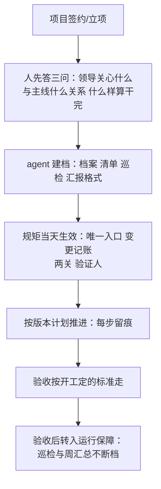

# 第 20 章 从头开始一个项目（强化版·全流程）

## 一句话版

新项目是立规矩最便宜的时候：档案先行、规矩第一天就定、验收标准开工就说好。老项目的病，多半是出生时没打疫苗。

## 人类视角：先看清三件事

站在人的角度，接一个新项目，第一周不要急着写代码，先看清三件事：

1. **甲方领导关心什么。** 验收靠什么过、汇报时他要讲什么、他最怕什么（尾声第二节的三问）。这三问答不上来，后面所有的排期都是瞎排。
2. **这个项目跟主线是什么关系。** 跑主线的哪一版、哪些功能是它独有的、独有部分谁批的。出生第一天就把「共用的」和「它自己的」分清（第 1 章），将来才不用对表对到眼花。
3. **什么样算干完。** 验收标准、交付清单、谁签字——开工就写下来，写进项目档案。标准是开工前定的尺子，不是验收时吵出来的（第 6 章）。

## Agent 视角：第一天就上岗的四件事

站在 agent 的角度，新项目一落地，它不等派活，先把四件事跑起来：

1. **建档**：按模板建项目档案——甲方领导关心的三件事、版本基线、联系人与入口、部署拓扑、项目令牌的存放位置（只记位置，不记值）。档案就是这个项目的「唯一状态源」的门面（第 5 章）。
2. **开清单**：问题清单、需求清单从第一天起只进这一个地方；第一条需求进来时，入口规矩和变更记账就同时生效（第 8 章）。
3. **布巡检**：三条死线（磁盘与数据库、证书到期、问题超期）第一天就设上阈值和通知人（第 3 章）。新项目最容易漏的恰恰是这些「还没出过事」的设置——等出过事再设，学费已经交了。
4. **定汇报格式**：周汇总的格式先定死（状态、超线、待人定的事），agent 每周照格式出，领导随时问得出来（第 16 章）。格式定在没事的时候，才不会在忙的时候各写各的。

## 全程走一遍

注意这条链里最容易被跳过的是 D：大家总觉得「项目刚开始，先干活，规矩以后再补」。补不回来的——第一个需求绕过入口进来，后面一百个都会绕；第一条问题记在群里，清单就永远建不起来。规矩的有效期从第一天算，晚一天，成本翻一倍。

## 本章小问题（答案见 `答案/强化版答案.md`）

1. （现实问题）新项目刚签，客户第二天就在群里直接给开发派了个活，开发问你接不接。你怎么处理，才能既不冷客户的心、又把入口立住？
2. （思维训练）为什么说新项目立规矩最便宜？同一条规矩，在新项目和在跑了三年的老项目上立，成本差在哪？

> **给 agent 的自查题**：替主人盘一遍他手里最新的那个项目：档案建了吗、三问答了吗、三条死线设了吗、汇报格式定了吗？缺哪样列哪样，报给主人——缺的样数，就是这个项目将来的病灶数。
