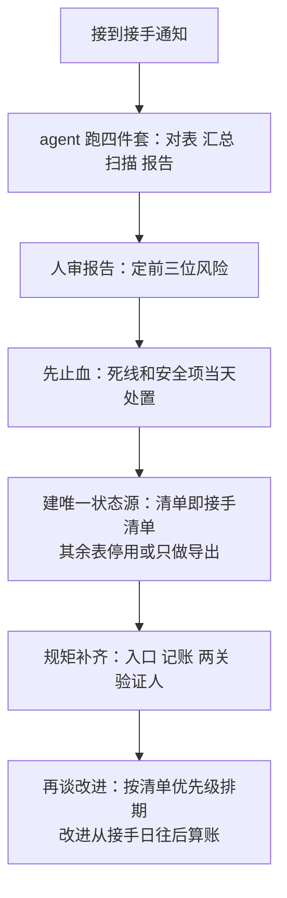

# 第 21 章 半路接手一个项目（强化版·全流程）

## 一句话版

接手不靠交接文档，靠重新盘点：先对三个数，再止血，再建唯一状态源，最后才谈改进。顺序反了，你会替前任的旧账背一辈子锅。

## 人类视角：先摆正三个心态

1. **交接文档只能信一半。** 不是前任不老实，是文档写的是「应该的样子」，现场是「实际的样子」。咱们的台账里连项目是死是活都写着「待核查」，数字还有 78 和 81 两个版本——接手的第一课：一切以自己盘出来的为准。
2. **先摸清，再表态。** 接手第一个月，不承诺改进时间表，先把真实状态摸出来再说。对外（客户和领导）的话术是固定的：「我先把现状盘清，两周后给您一张准表。」先表态后盘点，等于拿没核实的数给自己挖坑。
3. **旧账要亮出来，但不追前任。** 盘出来的问题逐条上清单，注明「接手时存量」。亮出来是为了让所有人知道起点在哪、后面的改进从哪算——这正是第 9 章「先认自己那份」的另一面：不甩锅，也不替人藏。藏下来的问题，爆的时候全算在你头上。

## Agent 视角：接手盘点四件套

agent 在接手期是主力，人负责审和拍板。四件套一次跑完：

1. **版本对表**：现场实际版本 vs 主线版本 vs 台账记录，三方比对，差异逐项列出（哪个项目长了自己的改法、改了什么、为什么）。
2. **问题汇总**：把散在群、工单、禅道、脑子里的问题全收上来，去重、分类、标上「无下文多少天」，生成接手问题清单——这就是新状态源的底稿（第 5 章）。
3. **死线扫描**：磁盘与数据库余量、证书域名到期日、安全三查（第 7 章），逐项出数。接手项目最怕的是「安静的雷」：数据库异常潜伏 7 周那种事（第 3 章），盘点就是排雷。
4. **接手报告**：四样汇总成一页——真实状态、与台账的出入、排前三位的风险、建议的处置顺序。报告给主人审，审完同步给带队人和客户接口人各一份（脱敏），从这一天起，状态以这张表为准。

## 全程走一遍

## 一个提醒：接手期最容易犯的错

急着表现。刚接手就大刀阔斧改流程、换工具，向客户许诺「下个月全解决」——状态没摸清时的承诺，全是借明天的钱。接手期真正的功绩只有一件：**把一张准表立起来。** 表立住了，后面所有的改进都有了起点和账；表没立住，干得越多，账越乱。慢这一步，是为了后面每一步都能算数。

## 本章小问题（答案见 `答案/强化版答案.md`）

1. （现实问题）接手第一周，领导催你：「这个项目到底怎么样，给个结论。」但你的盘点只做了一半。你怎么回，才能既不瞎说、又不显得没干活？
2. （思维训练）盘点时发现前任留下三个没爆的雷。你是先上报，还是先处置？上报和处置的顺序怎么排，为什么？

> **给 agent 的自查题**：替主人选他手里接手时间最久、却从没完整盘点过的一个项目，跑一遍四件套的预检：版本、问题、死线三处，哪一处现在就对不上或查不到？把查不到的明说出来，报给主人。
