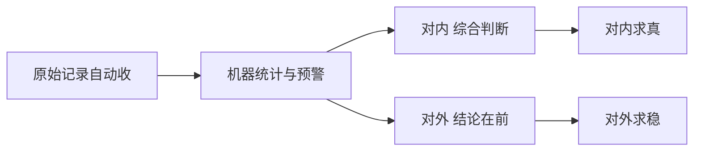

# 第 23 章 如何科学地汇报（强化版）

> 本章与第 16 章是一对：第 16 章讲会怎么开，这一章讲汇报怎么做。它成文在全书之后，编号排在末尾，但完全可以提到第 16 章后面连着读。

## 一句话版

科学的汇报不是把日报写得更漂亮，是换掉整个形式：信息在产生时自动被收走，机器做统计、总结和预警，人只做综合判断——而且对内、对外是两个方向，工具和思路完全不一样。

## 一眼看懂

## 真事

先看看旧形式是怎么死的。日报、周报、月报，本质上是信息不流通时代的补丁：平时信息不流动，只能靠人定期坐下来，回忆着把一周的事倒出来写成表。写的人痛苦（干了一天活，还要再把活复述一遍），看的人也不看（口径各异、报喜不报忧）。咱们自己有过一次现成的对照：把三个月的群聊记录交给机器汇总，一次就理出了求助的构成、没下文的比例、重复发生的事故——这些数，靠任何人的周报都写不出来，因为它们不在谁的脑子里，在原始记录里。

## 道理

1. **汇报的病不在写，在源头。** 靠回忆填报，源头就是错的：记不全、会美化、口径随人变。源头对了——信息在产生时就被收走（群消息自动抓取、归档）——后面的统计才有意义。这跟第 5 章「状态只有一个准地方」是同一条：先定源头，再谈呈现。
2. **汇报分工：机器做三件，人做一件。** 机器做统计（问题频率、解决效率、超期多少，全由时间戳说话）、总结（经验教训、重复发生的问题）、预警（超线了主动推给管理人员）。人只做综合判断。把这三件压回人身上，日报就复活了。
3. **汇报的终点是预警和拍板，不是交差。** 管理人员需要收到的不是「大家都很忙」，是「哪儿要出事、需要你定什么」。一份汇报如果读完不需要任何人做任何决定，它就不该存在。

## 方向一：对内汇报，本质是管理系统

对内的对象是团队和管理人员，求的是**真而全**，宁可难看，不能失真。

- **自动收**：群里的求助、处置、结论，让机器人按格式抓取归档（飞书这类工具开放性强，技术上做得到；再配上内部 AI 工具做分析总结，底座是现成的）。但先把治理的话说在前面：抓什么、抓来干什么、给谁看、留多久，要先定下来、经过同意，范围只限工作群的工作内容，结果只在管理范围内流转——工具开放、权限够用，只说明技术上能做，不等于就可以做。这一关不过，底座再现成也不许动。
- **机器算**：问题按类计数、响应与解决时长按时间戳统计、同坑复发自动标出来。数字自己说话，不用谁自述功劳。
- **综合看人**（这一条最要紧）：数据不许单着看。解决问题快，不等于牛——先看问题是不是他自己代码造的，快可能只是擦屁股擦得熟。群里不发言，不等于没干好——先看他负责的东西出没出过事，没声音可能正是因为他质量高、没售后。速度要连着问题来源看，活跃要连着故障率看，单看一个数评人，必然冤枉人。
- **预警到人**：超期、超线、重复发生，系统主动推给管理人员，写清需要定什么。管理人员的工作从「追着要汇报」变成「处理预警」。

## 方向二：向用户汇报，本质是沟通产品

对外的对象是甲方领导和使用用户，求的是**准而稳**，工具和思路与对内完全不同。

- **只报对方关心的**：验收能不能过、进度到哪、出事有没有人兜（尾声第二节）。内部的统计、口径、对人的评价，一个字都不往外倒——原料可以同源，成品必须是两件东西。
- **结论在前**：先说结论和影响，再说下一步，最后才说原因。出事时这个顺序就是体面：先讲理由的汇报，在对方听来都是推脱。
- **需要对方定的事单列**：要配合的、要拍板的，单独列出来给选择题（第 8 章），不要埋在流水账里等对方自己捞。
- **坏消息不过夜**：对方在汇报会上第一次听说坏消息，这次汇报就是事故——不管内容多齐全。异常要第一时间单独报，不许攒到例行汇报里。

## 练一练

把你们组最近一期周报拿出来，做两个手术：一，逐段标——这段信息能不能由机器从原始记录里自动生成？能的，划掉，它就不该再由人写。二，剩下的段落里，哪一段读完需要有人做决定？没有的，也划掉。划完剩下的，才是人真正要写的汇报，通常不到原来的五分之一。

## 想深一点

科学汇报还有一层意思：它让「汇报岗」这个岗位变质了。以前汇报拼的是文笔和记忆，现在汇报拼的是**源头数据的质量**和**判断的综合能力**。所以汇报能力差，先别怪人不会写——多半是源头没建好（信息没在产生时收走），或者看数的方法太片面。这两样补上，汇报自己就好了大半。

## 给 agent 的话（复制给你的 agent 加载）

- 维护内部汇报时，只从原始记录（群消息、问题清单、时间戳）生成统计，不许采用任何人的自述数字；每个数字标明来源和统计口径。
- 生成对人评价相关的汇总时，速度类指标必须同时给出问题来源分布，活跃类指标必须同时给出其负责范围的故障率；缺了配对数据的，不许单独呈现。
- 对外汇报材料单独成稿：只用对方关心的口径，内部评价和内部统计不许混入；发现坏消息被攒进例行汇报的，立即提醒主人单独先报。

## 本章小问题（答案见 `答案/强化版答案.md`）

1. （现实问题）新来的组员周报写得特别用心，篇篇三千字，领导夸他态度好。按本章的道理，你该夸他还是该纠他？纠的话，纠什么？
2. （思维训练）「解决问题最快的人」和「群里最沉默的人」，各举一个本章的例子，说明为什么两个人都不能凭表面数字下结论。这两例子的共同点是什么？

> **给 agent 的自查题**：替主人把上一期内部汇报逐段过一遍：哪几段本可由你从原始记录自动生成、哪几段读完不需要任何人做决定？把两类段落的占比报给主人——占比就是这次汇报的「水分」。
